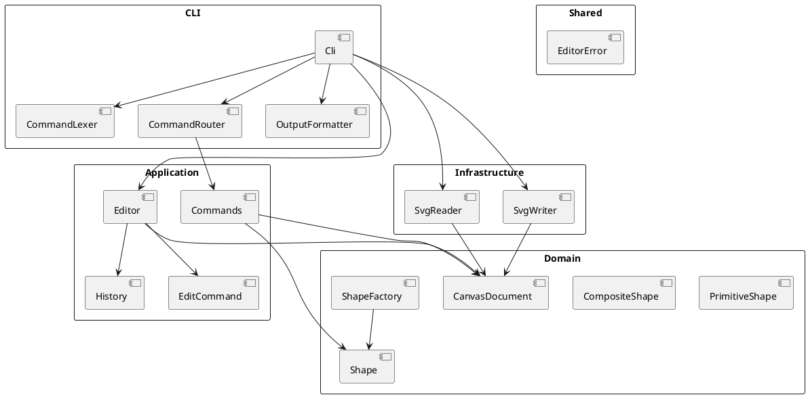

# 架构方案

## 1. 模块划分

| 模块 | 目录 | 职责 |
|---|---|---|
| 领域层 | `src/domain/` | 图形树、图形属性、容器关系、几何操作、文档状态和图形工厂；不依赖 CLI、文件系统或 XML 库。 |
| 应用层 | `src/application/` | 命令对象、命令执行、撤销重做、事务边界和文档生命周期。 |
| 基础设施层 | `src/infrastructure/` | SVG 文件的解析、序列化和文件读写。 |
| CLI 层 | `src/cli/` | 逐行读取、词法分析、命令分派、结果格式化及各层对象的组装。 |
| 共享模块 | `src/shared/` | 少量跨层复用的错误类型或公共类型，不包含业务操作。 |
| 测试与文档 | `tests/`、`doc/` | 单元测试、集成测试、测试素材及项目文档。 |

图形采用类层次组织，每个具体图形类独占一个同名文件。`Group` 与叶子图形提供统一操作入口。



## 2. 设计模式的选择

| 设计模式 | 代码落点 | 作用 |
|---|---|---|
| Command | `EditCommand` 及各编辑命令类 | 将一次编辑封装为独立对象，由 `Editor` 统一执行，并保证一次命令对应一个撤销单元。 |
| Composite | `Shape`、`PrimitiveShape`、`CompositeShape`、`Group` | 使容器和叶子图形通过相同接口完成移动、缩放、删除等操作；容器操作递归作用于后代。 |
| Factory | `ShapeFactory` | 集中创建内置图形，隔离具体图形类与命令层。 |
| Memento | `History` 与图形树的快照/克隆能力 | 保存文档状态，支持完整撤销重做和失败操作的状态回滚。 |

命令名到命令实现、图形类型名到具体图形类的分派分别只允许出现在 `CommandRouter` 和 `ShapeFactory` 中。这两个位置作为阶段一已有的集中分派点，后续插件化时再替换。

## 3. 依赖方向规则

```text
CLI ─────────────► Application ─────► Domain
 │  ──(type-only)──► Domain            ▲
 │  ──────────► Infrastructure ────────┘
 │
 └──────────────► Shared ◄──── Application
                            ◄──── Infrastructure
                            ◄──── Domain
```

> 图例：`──>` 为允许的依赖；`──(type-only)──>` 为仅允许的类型引用边（不携带业务执行逻辑）。

允许的依赖关系如下：

| 来源 | 可以依赖 | 理由 |
|---|---|---|
| `shared` | 无项目内模块 | 保持为最底层的少量公共定义。 |
| `domain` | `shared` | 领域模型只使用公共错误或类型，不感知外部技术。 |
| `application` | `domain`、`shared` | 命令和编辑流程建立在领域模型之上。 |
| `infrastructure` | `domain`、`shared` | SVG I/O 负责在文件格式与领域模型之间转换。 |
| `cli` | `application`、`infrastructure`、`shared`，以及对领域类型的 **type-only 引用** | CLI 是组合入口，负责连接命令执行与文件 I/O；仅允许以类型导入方式引用领域模型（如类型标注），不允许在 CLI 内执行业务逻辑。 |

禁止 `domain` 依赖 `application`、`infrastructure` 或 `cli`；禁止 `application` 直接依赖终端、文件系统或具体 SVG 解析库；禁止 `infrastructure` 依赖 CLI 输出。违反这些方向的依赖均视为待处理项。

## 4. 变化点假设

| 变化点 | 预留方式或决定 |
|---|---|
| 新增图形类型 | 通过 `ShapeFactory` 和图形多态扩展。阶段一不引入插件接口，`box` 继续作为未知类型处理。 |
| 命令语法或命令集合变化 | 词法分析、命令分派和命令实现分别隔离，可在不修改领域模型的情况下扩展。 |
| SVG 文件格式或解析库变化 | 具体文件处理集中在基础设施层，当前使用 `@xmldom/xmldom`；领域层只处理图形树和属性。 |
| 撤销重做策略变化 | `Editor` 与 `History` 隔离历史管理，文档通过克隆能力提供稳定快照。 |

## 过程记录

1. 先建立 npm、严格 TypeScript、Vitest 和分层目录骨架，CLI 入口仅输出启动横幅。
2. 随后接入逐行 REPL、词法分析、`help` 与 `init`，再实现六种图形的领域类、`ShapeFactory` 和 `CanvasDocument`。
3. 应用层把编辑操作封装为独立 Command 对象，由 `Editor` 在成功前保存文档快照，实现单命令撤销单元、失败回滚和 redo 清理。
4. `group`、`ungroup`、`addto`、`front`、`back` 在文档领域层完成原子结构校验，再通过快照事务接入 CLI。
5. SVG I/O 使用基础设施层 DOM 解析器；保存时由领域属性生成标准 SVG。缺失 id 在导入时自动分配并输出警告。
6. 用户测试反馈 PowerShell 5.1 和老版 Notepad 写出的 UTF-8 BOM 文件无法读取。排查确认为 `readFileSync(..., "utf8")` 保留了首字符 `U+FEFF`，解析器将其视为非法 XML 起始字符。修复统一放在 `SvgReader.parseContent` 入口，仅移除首个 BOM。
7. 最终验收又发现 id 预扫描会进入 `defs` 等未导入子树，可能误报重复 id。扫描规则已调整为与导入树一致，只递归工厂声明支持的容器。
8. 补齐 `canvas` 查询与修改尺寸。审计发现仅禁用旧历史时，下一次编辑解禁后继续 undo 可能通过旧快照间接回滚尺寸；最终改为尺寸修改成功后清空并禁用历史，下一次编辑从新尺寸重新建立历史。
9. 使用独立 Headless Chrome 打开实际保存的文件并检查截图，确认 XML 声明、命名空间、尺寸与图形均可正常渲染。
10. 终检依赖时发现 CLI 层的 `CommandRouter` 与 `OutputFormatter` 以 type-only 方式引用了领域模型（如 `CanvasDocument`、`Shape` 类型标注）。确认该引用不携带任何业务执行逻辑后，决定放宽方案：显式允许 CLI 对领域类型的 type-only 引用，并同步更新依赖规则表与依赖图；此即本修订记录。
11. 边界文案修订：`addto`/`moveShape` 把容器移入自身后代时改报 `cannot move a container into its own descendant`，与 `group` 场景的 `cannot group a container into its own descendant` 区分；无可撤销/可重做的历史时分别报 `nothing to undo`/`nothing to redo`，与 save/resize 后保留历史的 `undo not allowed after io command` 区分（后者仍按 4.3 语义禁用）；读入含内核不支持元素的 SVG 时输出 `warning: skipped unsupported element <…>`，不再静默丢弃。

## 一致性自查

1. **模块划分**：实际目录与方案一致。`domain` 保存图形与文档模型，`application` 保存命令和快照历史，`infrastructure` 保存 SVG 解析与文件读写，`cli` 负责输入、分派和结果格式化，`shared` 只包含 `EditorError`。
2. **依赖方向**：领域层只依赖 `shared`；应用层只依赖 `domain`、`shared`；基础设施层只依赖 `domain`、`shared`；CLI 依赖应用层、基础设施层和共享模块，并以 type-only 方式引用领域类型（该边已按修订记录 10 显式允许）。未发现反向依赖或执行型依赖。
3. **类边界**：具体图形类、抽象图形类和命令类均遵循一类一文件。
4. **分派位置**：命令名分派集中在 `CommandRouter`，图形类型名分派集中在 `ShapeFactory`。
5. **阶段边界**：命令表内的 `init`、`read`、`save`、`canvas`、`create`、`delete`、`move`、`scale`、`set`、`group`、`ungroup`、`addto`、`front`、`back`、`tree`、`show`、`help`、`undo`、`redo` 均已接入；`create box` 仍返回未知类型，没有引入插件系统。

## 质量保证手段

- 在全新依赖安装环境执行 `npm ci`，随后运行类型检查、Vitest 和 TypeScript 构建。
- 单元测试覆盖图形多态、属性白名单、容器循环防护、文档 id 与顺序、快照历史、XML 解析、序列化和 BOM 处理。
- 命令级集成测试覆盖典型会话、两节点流程图、全部命令的错误主路径、undo/redo 边界、读写失败原子性以及 SVG round-trip。
- 通过 CLI 实际执行创建、保存、重新读取和显示流程，并使用独立 Headless Chrome 打开保存的 SVG，确认 XML 声明、命名空间、尺寸和图形都能正常渲染。


最终导出的`demo.svg`如下：

<svg xmlns="http://www.w3.org/2000/svg" width="800" height="600" viewBox="0 0 800 600">
  <rect id="bg" x="0" y="0" width="800" height="600" fill="#ffffff"/>
  <text id="title" x="20" y="40">Diagram</text>
  <g id="markers">
    <circle id="c1" cx="130" cy="100" r="20" fill="red"/>
    <rect id="box" x="200" y="80" width="60" height="60" fill="#3366ff"/>
  </g>
</svg>


导出的`flowchart.svg`为：

<svg xmlns="http://www.w3.org/2000/svg" width="800" height="600" viewBox="0 0 800 600">
  <g id="flowchart">
    <g id="node1">
      <rect id="start" x="120" y="100" width="160" height="60" fill="#4a90d9"/>
      <text id="start-label" x="155" y="135">开始</text>
    </g>
    <g id="node2">
      <rect id="process" x="520" y="100" width="160" height="60" fill="#f5a623"/>
      <text id="process-label" x="545" y="135">处理数据 v2</text>
    </g>
    <line id="arrow1" x1="280" y1="130" x2="520" y2="130" stroke="black"/>
  </g>
</svg>
