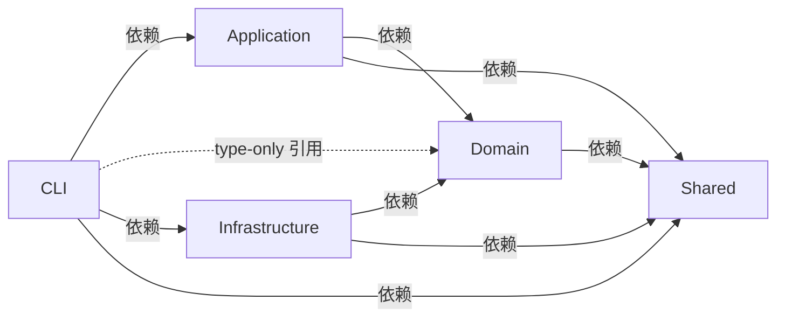
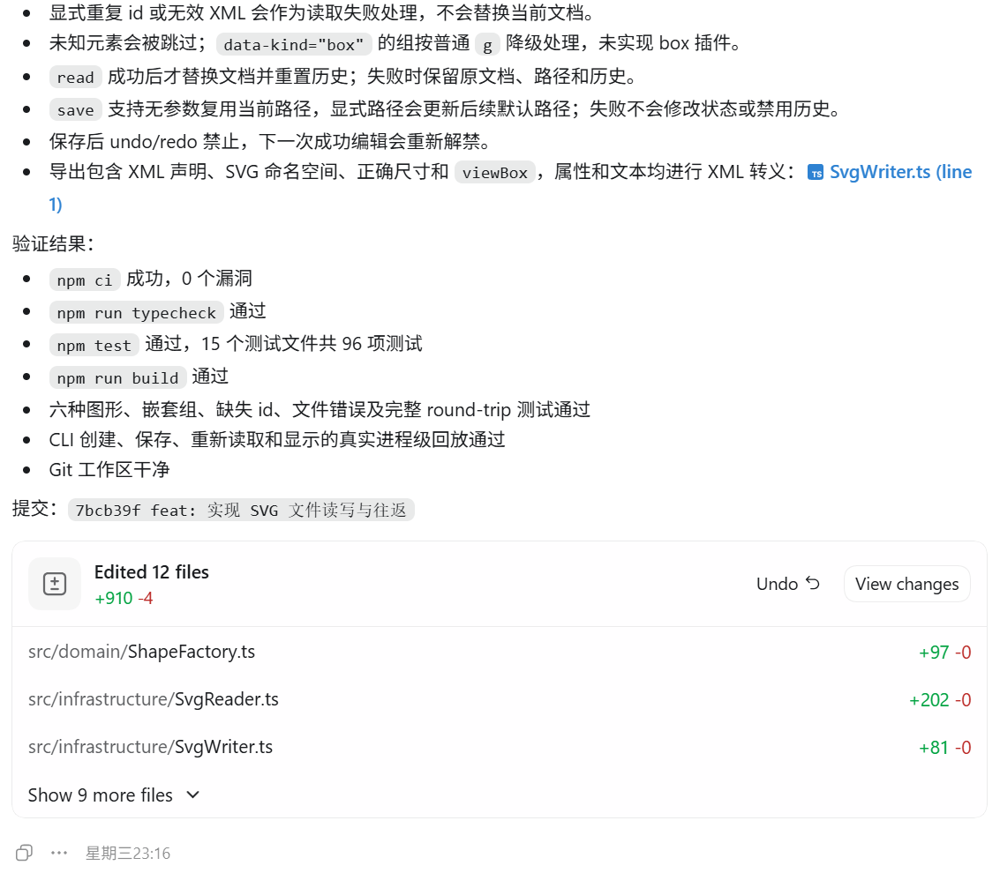
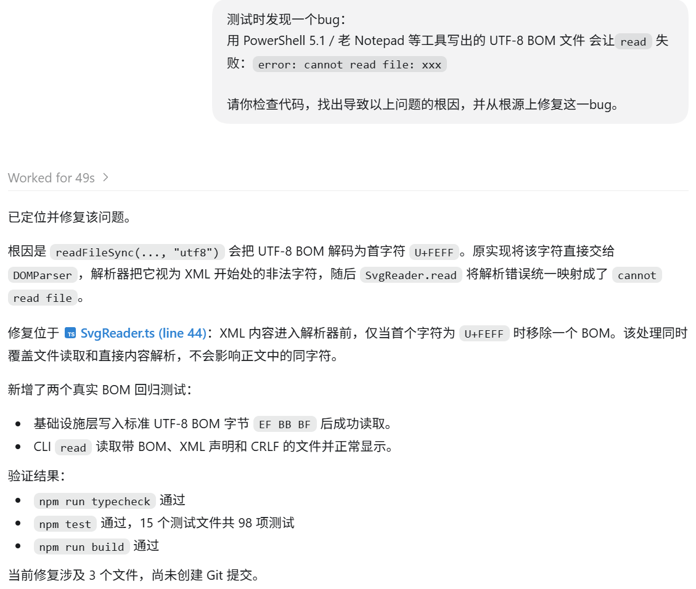
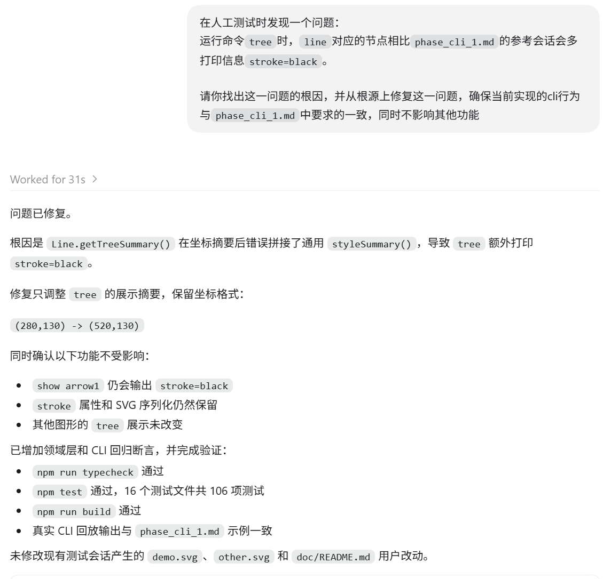
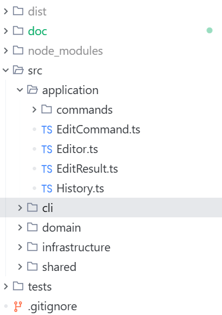
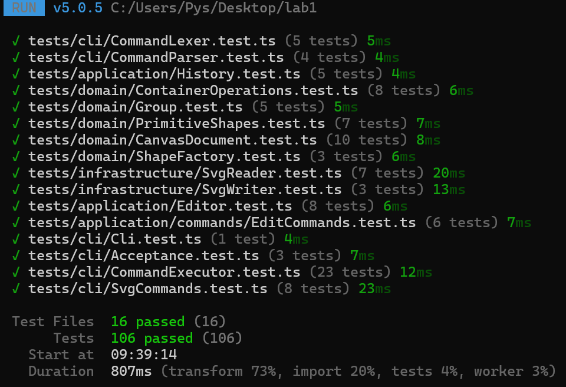
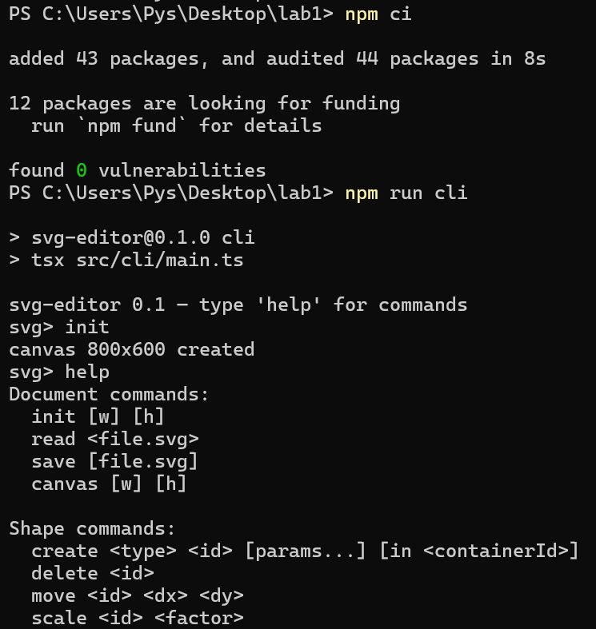

# 架构方案

## 1. 模块划分

| 模块 | 目录 | 职责 |
|---|---|---|
| 领域层 | `src/domain/` | 图形树、图形属性、容器关系、几何操作、文档状态和图形工厂；不依赖 CLI、文件系统或 XML 库。 |
| 应用层 | `src/application/` | 命令对象、命令执行、撤销重做、事务边界和文档生命周期。 |
| 基础设施层 | `src/infrastructure/` | SVG 文件的解析、序列化和文件读写。 |
| CLI 层 | `src/cli/` | 逐行读取、词法分析、命令分派、结果格式化及各层对象的组装。 |
| 共享模块 | `src/shared/` | 少量跨层复用的错误类型或公共类型，不包含业务操作。 |
| 测试与文档 | `tests/`、`doc/` | 单元测试、集成测试、测试素材及项目文档。 |

对应的 PlantUML 图如下：

<svg xmlns="http://www.w3.org/2000/svg" xmlns:xlink="http://www.w3.org/1999/xlink" version="1.1" data-diagram-type="DESCRIPTION" style="width:1163px;height:573px;background:#FFFFFF;" width="1163px" height="573px" viewBox="0 0 1163 573" zoomAndPan="magnify" preserveAspectRatio="none" contentStyleType="text/css"><?plantuml 1.2026.9beta4?><defs/><g font-family="sans-serif" lengthAdjust="spacing"><!--cluster CLI--><g class="cluster" data-qualified-name="CLI" id="ent0001" data-source-line="3"><rect x="7" y="7" width="571" height="203.59" fill="none" style="stroke:#181818;stroke-width:1;" rx="2.5" ry="2.5"/><text x="280.298" y="21.995" fill="#000" font-size="14" textLength="24.404" font-weight="700">CLI</text></g><!--cluster Application--><g class="cluster" data-qualified-name="Application" id="ent0006" data-source-line="10"><rect x="38" y="234.59" width="296" height="218.59" fill="none" style="stroke:#181818;stroke-width:1;" rx="2.5" ry="2.5"/><text x="141.351" y="249.585" fill="#000" font-size="14" textLength="89.298" font-weight="700">Application</text></g><!--cluster Domain--><g class="cluster" data-qualified-name="Domain" id="ent0011" data-source-line="17"><rect x="408" y="355.89" width="741" height="203.59" fill="none" style="stroke:#181818;stroke-width:1;" rx="2.5" ry="2.5"/><text x="748.48" y="370.885" fill="#000" font-size="14" textLength="60.04" font-weight="700">Domain</text></g><!--cluster Infrastructure--><g class="cluster" data-qualified-name="Infrastructure" id="ent0017" data-source-line="25"><rect x="646" y="234.59" width="293" height="97.3" fill="none" style="stroke:#181818;stroke-width:1;" rx="2.5" ry="2.5"/><text x="737.064" y="249.585" fill="#000" font-size="14" textLength="110.872" font-weight="700">Infrastructure</text></g><!--cluster Shared--><g class="cluster" data-qualified-name="Shared" id="ent0020" data-source-line="30"><rect x="801" y="7" width="148" height="97.29" fill="none" style="stroke:#181818;stroke-width:1;" rx="2.5" ry="2.5"/><text x="847.041" y="21.995" fill="#000" font-size="14" textLength="55.918" font-weight="700">Shared</text></g><!--entity CommandLexer--><g class="entity" data-qualified-name="CLI.CommandLexer" id="ent0002" data-source-line="4"><rect x="23.49" y="148.29" width="151.022" height="46.297" fill="#F1F1F1" style="stroke:#181818;stroke-width:0.5;" rx="2.5" ry="2.5"/><rect x="154.512" y="153.29" width="15" height="10" fill="#F1F1F1" style="stroke:#181818;stroke-width:0.5;"/><rect x="152.512" y="155.29" width="4" height="2" fill="#F1F1F1" style="stroke:#181818;stroke-width:0.5;"/><rect x="152.512" y="159.29" width="4" height="2" fill="#F1F1F1" style="stroke:#181818;stroke-width:0.5;"/><text x="38.49" y="181.285" fill="#000" font-size="14" textLength="111.022">CommandLexer</text></g><!--entity CommandRouter--><g class="entity" data-qualified-name="CLI.CommandRouter" id="ent0003" data-source-line="5"><rect x="209.51" y="148.29" width="158.979" height="46.297" fill="#F1F1F1" style="stroke:#181818;stroke-width:0.5;" rx="2.5" ry="2.5"/><rect x="348.489" y="153.29" width="15" height="10" fill="#F1F1F1" style="stroke:#181818;stroke-width:0.5;"/><rect x="346.489" y="155.29" width="4" height="2" fill="#F1F1F1" style="stroke:#181818;stroke-width:0.5;"/><rect x="346.489" y="159.29" width="4" height="2" fill="#F1F1F1" style="stroke:#181818;stroke-width:0.5;"/><text x="224.51" y="181.285" fill="#000" font-size="14" textLength="118.979">CommandRouter</text></g><!--entity OutputFormatter--><g class="entity" data-qualified-name="CLI.OutputFormatter" id="ent0004" data-source-line="6"><rect x="403.72" y="148.29" width="158.569" height="46.297" fill="#F1F1F1" style="stroke:#181818;stroke-width:0.5;" rx="2.5" ry="2.5"/><rect x="542.289" y="153.29" width="15" height="10" fill="#F1F1F1" style="stroke:#181818;stroke-width:0.5;"/><rect x="540.289" y="155.29" width="4" height="2" fill="#F1F1F1" style="stroke:#181818;stroke-width:0.5;"/><rect x="540.289" y="159.29" width="4" height="2" fill="#F1F1F1" style="stroke:#181818;stroke-width:0.5;"/><text x="418.72" y="181.285" fill="#000" font-size="14" textLength="118.569">OutputFormatter</text></g><!--entity Cli--><g class="entity" data-qualified-name="CLI.Cli" id="ent0005" data-source-line="7"><rect x="479.22" y="42" width="57.555" height="46.297" fill="#F1F1F1" style="stroke:#181818;stroke-width:0.5;" rx="2.5" ry="2.5"/><rect x="516.775" y="47" width="15" height="10" fill="#F1F1F1" style="stroke:#181818;stroke-width:0.5;"/><rect x="514.775" y="49" width="4" height="2" fill="#F1F1F1" style="stroke:#181818;stroke-width:0.5;"/><rect x="514.775" y="53" width="4" height="2" fill="#F1F1F1" style="stroke:#181818;stroke-width:0.5;"/><text x="494.22" y="74.995" fill="#000" font-size="14" textLength="17.555">Cli</text></g><!--entity Editor--><g class="entity" data-qualified-name="Application.Editor" id="ent0007" data-source-line="11"><rect x="82.28" y="269.59" width="81.433" height="46.297" fill="#F1F1F1" style="stroke:#181818;stroke-width:0.5;" rx="2.5" ry="2.5"/><rect x="143.713" y="274.59" width="15" height="10" fill="#F1F1F1" style="stroke:#181818;stroke-width:0.5;"/><rect x="141.713" y="276.59" width="4" height="2" fill="#F1F1F1" style="stroke:#181818;stroke-width:0.5;"/><rect x="141.713" y="280.59" width="4" height="2" fill="#F1F1F1" style="stroke:#181818;stroke-width:0.5;"/><text x="97.28" y="302.585" fill="#000" font-size="14" textLength="41.433">Editor</text></g><!--entity History--><g class="entity" data-qualified-name="Application.History" id="ent0008" data-source-line="12"><rect x="54.1" y="390.89" width="89.807" height="46.297" fill="#F1F1F1" style="stroke:#181818;stroke-width:0.5;" rx="2.5" ry="2.5"/><rect x="123.907" y="395.89" width="15" height="10" fill="#F1F1F1" style="stroke:#181818;stroke-width:0.5;"/><rect x="121.907" y="397.89" width="4" height="2" fill="#F1F1F1" style="stroke:#181818;stroke-width:0.5;"/><rect x="121.907" y="401.89" width="4" height="2" fill="#F1F1F1" style="stroke:#181818;stroke-width:0.5;"/><text x="69.1" y="423.885" fill="#000" font-size="14" textLength="49.807">History</text></g><!--entity EditCommand--><g class="entity" data-qualified-name="Application.EditCommand" id="ent0009" data-source-line="13"><rect x="178.47" y="390.89" width="139.066" height="46.297" fill="#F1F1F1" style="stroke:#181818;stroke-width:0.5;" rx="2.5" ry="2.5"/><rect x="297.536" y="395.89" width="15" height="10" fill="#F1F1F1" style="stroke:#181818;stroke-width:0.5;"/><rect x="295.536" y="397.89" width="4" height="2" fill="#F1F1F1" style="stroke:#181818;stroke-width:0.5;"/><rect x="295.536" y="401.89" width="4" height="2" fill="#F1F1F1" style="stroke:#181818;stroke-width:0.5;"/><text x="193.47" y="423.885" fill="#000" font-size="14" textLength="99.066">EditCommand</text></g><!--entity Commands--><g class="entity" data-qualified-name="Application.Commands" id="ent0010" data-source-line="14"><rect x="198.38" y="269.59" width="119.249" height="46.297" fill="#F1F1F1" style="stroke:#181818;stroke-width:0.5;" rx="2.5" ry="2.5"/><rect x="297.629" y="274.59" width="15" height="10" fill="#F1F1F1" style="stroke:#181818;stroke-width:0.5;"/><rect x="295.629" y="276.59" width="4" height="2" fill="#F1F1F1" style="stroke:#181818;stroke-width:0.5;"/><rect x="295.629" y="280.59" width="4" height="2" fill="#F1F1F1" style="stroke:#181818;stroke-width:0.5;"/><text x="213.38" y="302.585" fill="#000" font-size="14" textLength="79.249">Commands</text></g><!--entity Shape--><g class="entity" data-qualified-name="Domain.Shape" id="ent0012" data-source-line="18"><rect x="723.08" y="497.18" width="83.839" height="46.297" fill="#F1F1F1" style="stroke:#181818;stroke-width:0.5;" rx="2.5" ry="2.5"/><rect x="786.919" y="502.18" width="15" height="10" fill="#F1F1F1" style="stroke:#181818;stroke-width:0.5;"/><rect x="784.919" y="504.18" width="4" height="2" fill="#F1F1F1" style="stroke:#181818;stroke-width:0.5;"/><rect x="784.919" y="508.18" width="4" height="2" fill="#F1F1F1" style="stroke:#181818;stroke-width:0.5;"/><text x="738.08" y="530.175" fill="#000" font-size="14" textLength="43.839">Shape</text></g><!--entity CompositeShape--><g class="entity" data-qualified-name="Domain.CompositeShape" id="ent0014" data-source-line="20"><rect x="604.72" y="390.89" width="158.556" height="46.297" fill="#F1F1F1" style="stroke:#181818;stroke-width:0.5;" rx="2.5" ry="2.5"/><rect x="743.276" y="395.89" width="15" height="10" fill="#F1F1F1" style="stroke:#181818;stroke-width:0.5;"/><rect x="741.276" y="397.89" width="4" height="2" fill="#F1F1F1" style="stroke:#181818;stroke-width:0.5;"/><rect x="741.276" y="401.89" width="4" height="2" fill="#F1F1F1" style="stroke:#181818;stroke-width:0.5;"/><text x="619.72" y="423.885" fill="#000" font-size="14" textLength="118.556">CompositeShape</text></g><!--entity CanvasDocument--><g class="entity" data-qualified-name="Domain.CanvasDocument" id="ent0015" data-source-line="21"><rect x="798.04" y="390.89" width="163.915" height="46.297" fill="#F1F1F1" style="stroke:#181818;stroke-width:0.5;" rx="2.5" ry="2.5"/><rect x="941.955" y="395.89" width="15" height="10" fill="#F1F1F1" style="stroke:#181818;stroke-width:0.5;"/><rect x="939.955" y="397.89" width="4" height="2" fill="#F1F1F1" style="stroke:#181818;stroke-width:0.5;"/><rect x="939.955" y="401.89" width="4" height="2" fill="#F1F1F1" style="stroke:#181818;stroke-width:0.5;"/><text x="813.04" y="423.885" fill="#000" font-size="14" textLength="123.915">CanvasDocument</text></g><!--entity ShapeFactory--><g class="entity" data-qualified-name="Domain.ShapeFactory" id="ent0016" data-source-line="22"><rect x="996.87" y="390.89" width="136.264" height="46.297" fill="#F1F1F1" style="stroke:#181818;stroke-width:0.5;" rx="2.5" ry="2.5"/><rect x="1113.134" y="395.89" width="15" height="10" fill="#F1F1F1" style="stroke:#181818;stroke-width:0.5;"/><rect x="1111.134" y="397.89" width="4" height="2" fill="#F1F1F1" style="stroke:#181818;stroke-width:0.5;"/><rect x="1111.134" y="401.89" width="4" height="2" fill="#F1F1F1" style="stroke:#181818;stroke-width:0.5;"/><text x="1011.87" y="423.885" fill="#000" font-size="14" textLength="96.264">ShapeFactory</text></g><!--entity SvgReader--><g class="entity" data-qualified-name="Infrastructure.SvgReader" id="ent0018" data-source-line="26"><rect x="661.88" y="269.59" width="116.234" height="46.297" fill="#F1F1F1" style="stroke:#181818;stroke-width:0.5;" rx="2.5" ry="2.5"/><rect x="758.114" y="274.59" width="15" height="10" fill="#F1F1F1" style="stroke:#181818;stroke-width:0.5;"/><rect x="756.114" y="276.59" width="4" height="2" fill="#F1F1F1" style="stroke:#181818;stroke-width:0.5;"/><rect x="756.114" y="280.59" width="4" height="2" fill="#F1F1F1" style="stroke:#181818;stroke-width:0.5;"/><text x="676.88" y="302.585" fill="#000" font-size="14" textLength="76.234">SvgReader</text></g><!--entity SvgWriter--><g class="entity" data-qualified-name="Infrastructure.SvgWriter" id="ent0019" data-source-line="27"><rect x="813.3" y="269.59" width="109.405" height="46.297" fill="#F1F1F1" style="stroke:#181818;stroke-width:0.5;" rx="2.5" ry="2.5"/><rect x="902.705" y="274.59" width="15" height="10" fill="#F1F1F1" style="stroke:#181818;stroke-width:0.5;"/><rect x="900.705" y="276.59" width="4" height="2" fill="#F1F1F1" style="stroke:#181818;stroke-width:0.5;"/><rect x="900.705" y="280.59" width="4" height="2" fill="#F1F1F1" style="stroke:#181818;stroke-width:0.5;"/><text x="828.3" y="302.585" fill="#000" font-size="14" textLength="69.405">SvgWriter</text></g><!--entity EditorError--><g class="entity" data-qualified-name="Shared.EditorError" id="ent0021" data-source-line="31"><rect x="816.94" y="42" width="116.111" height="46.297" fill="#F1F1F1" style="stroke:#181818;stroke-width:0.5;" rx="2.5" ry="2.5"/><rect x="913.051" y="47" width="15" height="10" fill="#F1F1F1" style="stroke:#181818;stroke-width:0.5;"/><rect x="911.051" y="49" width="4" height="2" fill="#F1F1F1" style="stroke:#181818;stroke-width:0.5;"/><rect x="911.051" y="53" width="4" height="2" fill="#F1F1F1" style="stroke:#181818;stroke-width:0.5;"/><text x="831.94" y="74.995" fill="#000" font-size="14" textLength="76.111">EditorError</text></g><!--link Cli to CommandLexer--><g class="link" data-entity-1="ent0005" data-entity-2="ent0002" id="lnk22" data-source-line="34" data-link-type="dependency"><path d="M478.91,73.56 C416.23,89.55 271.495,126.455 179.835,149.825" style="stroke:#181818;stroke-width:1;" fill="none" id="Cli-to-CommandLexer"/><polygon points="174.99,151.06,184.699,152.712,179.835,149.825,182.723,144.96,174.99,151.06" fill="#181818" style="stroke:#181818;stroke-width:1;stroke-linejoin:miter;stroke-miterlimit:10;"/></g><!--link Cli to CommandRouter--><g class="link" data-entity-1="ent0005" data-entity-2="ent0003" id="lnk23" data-source-line="35" data-link-type="dependency"><path d="M478.92,79.99 C442.5,97.34 384.144,125.131 340.774,145.781" style="stroke:#181818;stroke-width:1;" fill="none" id="Cli-to-CommandRouter"/><polygon points="336.26,147.93,346.105,147.672,340.774,145.781,342.666,140.449,336.26,147.93" fill="#181818" style="stroke:#181818;stroke-width:1;stroke-linejoin:miter;stroke-miterlimit:10;"/></g><!--link Cli to OutputFormatter--><g class="link" data-entity-1="ent0005" data-entity-2="ent0004" id="lnk24" data-source-line="36" data-link-type="dependency"><path d="M502.58,88.77 C498.38,106.27 493.765,125.508 489.575,142.988" style="stroke:#181818;stroke-width:1;" fill="none" id="Cli-to-OutputFormatter"/><polygon points="488.41,147.85,494.398,140.03,489.575,142.988,486.618,138.166,488.41,147.85" fill="#181818" style="stroke:#181818;stroke-width:1;stroke-linejoin:miter;stroke-miterlimit:10;"/></g><!--link Cli to Editor--><g class="link" data-entity-1="ent0005" data-entity-2="ent0007" id="lnk25" data-source-line="37" data-link-type="dependency"><path d="M533.02,88.53 C566.3,120.88 616.88,180.96 580,218.59 C564.48,234.42 201.14,217.31 181,226.59 C161.74,235.46 148.987,249.959 138.857,265.049" style="stroke:#181818;stroke-width:1;" fill="none" id="Cli-to-Editor"/><polygon points="136.07,269.2,144.407,263.957,138.857,265.049,137.765,259.498,136.07,269.2" fill="#181818" style="stroke:#181818;stroke-width:1;stroke-linejoin:miter;stroke-miterlimit:10;"/></g><!--link Cli to SvgReader--><g class="link" data-entity-1="ent0005" data-entity-2="ent0018" id="lnk26" data-source-line="38" data-link-type="dependency"><path d="M537.18,78.74 C566.32,92.46 610.98,116.73 641,148.29 C675.59,184.65 698.208,234.404 710.058,264.694" style="stroke:#181818;stroke-width:1;" fill="none" id="Cli-to-SvgReader"/><polygon points="711.88,269.35,712.326,259.511,710.058,264.694,704.876,262.426,711.88,269.35" fill="#181818" style="stroke:#181818;stroke-width:1;stroke-linejoin:miter;stroke-miterlimit:10;"/></g><!--link Cli to SvgWriter--><g class="link" data-entity-1="ent0005" data-entity-2="ent0019" id="lnk27" data-source-line="39" data-link-type="dependency"><path d="M536.99,77.01 C573.71,91.27 638.41,118.06 690,148.29 C740.53,177.91 750.67,189.5 796,226.59 C812.57,240.15 826.759,252.884 840.539,265.704" style="stroke:#181818;stroke-width:1;" fill="none" id="Cli-to-SvgWriter"/><polygon points="844.2,269.11,840.335,260.051,840.539,265.704,834.886,265.908,844.2,269.11" fill="#181818" style="stroke:#181818;stroke-width:1;stroke-linejoin:miter;stroke-miterlimit:10;"/></g><!--link CommandRouter to Commands--><g class="link" data-entity-1="ent0003" data-entity-2="ent0010" id="lnk28" data-source-line="40" data-link-type="dependency"><path d="M283.17,194.88 C277.63,216.21 270.599,243.261 265.059,264.561" style="stroke:#181818;stroke-width:1;" fill="none" id="CommandRouter-to-Commands"/><polygon points="263.8,269.4,269.937,261.697,265.059,264.561,262.194,259.683,263.8,269.4" fill="#181818" style="stroke:#181818;stroke-width:1;stroke-linejoin:miter;stroke-miterlimit:10;"/></g><!--link Editor to History--><g class="link" data-entity-1="ent0007" data-entity-2="ent0008" id="lnk29" data-source-line="41" data-link-type="dependency"><path d="M118.49,316.18 C114.19,337.51 108.767,364.498 104.477,385.798" style="stroke:#181818;stroke-width:1;" fill="none" id="Editor-to-History"/><polygon points="103.49,390.7,109.188,382.667,104.477,385.798,101.346,381.087,103.49,390.7" fill="#181818" style="stroke:#181818;stroke-width:1;stroke-linejoin:miter;stroke-miterlimit:10;"/></g><!--link Editor to EditCommand--><g class="link" data-entity-1="ent0007" data-entity-2="ent0009" id="lnk30" data-source-line="42" data-link-type="dependency"><path d="M146.51,316.18 C168.86,337.51 198.664,365.947 220.974,387.247" style="stroke:#181818;stroke-width:1;" fill="none" id="Editor-to-EditCommand"/><polygon points="224.59,390.7,220.843,381.592,220.974,387.247,215.318,387.378,224.59,390.7" fill="#181818" style="stroke:#181818;stroke-width:1;stroke-linejoin:miter;stroke-miterlimit:10;"/></g><!--link Editor to CanvasDocument--><g class="link" data-entity-1="ent0007" data-entity-2="ent0015" id="lnk31" data-source-line="43" data-link-type="dependency"><path d="M144.25,316.28 C154.4,325.44 167.3,335 181,339.89 C243.8,362.29 717.26,328.33 781,347.89 C808.74,356.4 832.064,372.144 850.924,387.414" style="stroke:#181818;stroke-width:1;" fill="none" id="Editor-to-CanvasDocument"/><polygon points="854.81,390.56,850.332,381.788,850.924,387.414,845.298,388.005,854.81,390.56" fill="#181818" style="stroke:#181818;stroke-width:1;stroke-linejoin:miter;stroke-miterlimit:10;"/></g><!--link Commands to Shape--><g class="link" data-entity-1="ent0010" data-entity-2="ent0012" id="lnk32" data-source-line="44" data-link-type="dependency"><path d="M296.36,316.38 C309.5,325.21 323.72,336.06 335,347.89 C376.19,391.05 357.19,428.34 407,461.18 C458.32,495.02 634.622,510.727 717.772,516.437" style="stroke:#181818;stroke-width:1;" fill="none" id="Commands-to-Shape"/><polygon points="722.76,516.78,714.055,512.173,717.772,516.437,713.507,520.154,722.76,516.78" fill="#181818" style="stroke:#181818;stroke-width:1;stroke-linejoin:miter;stroke-miterlimit:10;"/></g><!--link Commands to CanvasDocument--><g class="link" data-entity-1="ent0010" data-entity-2="ent0015" id="lnk33" data-source-line="45" data-link-type="dependency"><path d="M318.04,302 C394.19,312.21 529.61,329.53 646,339.89 C675.93,342.55 752.48,338.42 781,347.89 C808.34,356.96 831.466,372.489 850.366,387.509" style="stroke:#181818;stroke-width:1;" fill="none" id="Commands-to-CanvasDocument"/><polygon points="854.28,390.62,849.723,381.889,850.366,387.509,844.745,388.152,854.28,390.62" fill="#181818" style="stroke:#181818;stroke-width:1;stroke-linejoin:miter;stroke-miterlimit:10;"/></g><!--link ShapeFactory to Shape--><g class="link" data-entity-1="ent0016" data-entity-2="ent0012" id="lnk34" data-source-line="46" data-link-type="dependency"><path d="M1027.36,437.63 C1012.64,445.83 995.37,454.66 979,461.18 C921.23,484.18 856.067,500.251 812.227,509.751" style="stroke:#181818;stroke-width:1;" fill="none" id="ShapeFactory-to-Shape"/><polygon points="807.34,510.81,816.983,512.813,812.227,509.751,815.289,504.995,807.34,510.81" fill="#181818" style="stroke:#181818;stroke-width:1;stroke-linejoin:miter;stroke-miterlimit:10;"/></g><!--link SvgReader to CanvasDocument--><g class="link" data-entity-1="ent0018" data-entity-2="ent0015" id="lnk35" data-source-line="47" data-link-type="dependency"><path d="M750.09,316.18 C778.61,337.44 817.201,366.212 845.761,387.502" style="stroke:#181818;stroke-width:1;" fill="none" id="SvgReader-to-CanvasDocument"/><polygon points="849.77,390.49,844.945,381.904,845.761,387.502,840.164,388.318,849.77,390.49" fill="#181818" style="stroke:#181818;stroke-width:1;stroke-linejoin:miter;stroke-miterlimit:10;"/></g><!--link SvgWriter to CanvasDocument--><g class="link" data-entity-1="ent0019" data-entity-2="ent0015" id="lnk36" data-source-line="48" data-link-type="dependency"><path d="M870.26,316.18 C872.4,337.51 875.11,364.425 877.25,385.725" style="stroke:#181818;stroke-width:1;" fill="none" id="SvgWriter-to-CanvasDocument"/><polygon points="877.75,390.7,880.83,381.345,877.25,385.725,872.87,382.145,877.75,390.7" fill="#181818" style="stroke:#181818;stroke-width:1;stroke-linejoin:miter;stroke-miterlimit:10;"/></g><?plantuml-src TP5DQyCm38Rl-HMcz_w5mUW7AnGssaCF8mUHU9be_84iXvMn_xwGs8cTR3VxaVHAUkNkg2qGA66XkaCZh_nefI1PCUYcbKKHkDZipgUD-2w4UDyPfK3NP_abgKp0nNWEvDMpzNmqf80ZsxLO5Z-9uhErBLR0Q7HGFjJ8Pin-GTS_7sN4eKVQp-LoUwC0ezBr4wmSajy85J9sSaPzlJKEEKMWEt1xKtabDPUJn16gSOoqqqb_43WcNx4d6JjspKL27PRjVpV2OVMqijSaMMVR7eZCc3Ku9BRRfwN5wq2qEeciB4zYqTS49UFcD8wzQ9MrxvsFcYEVhfNZx71vQ6duB1qc6K-pnAkox4fvwRpYVxNJjdyc_080?></g></svg>

## 2. 设计模式的选择

本次 lab 使用了**四种设计模式**，分别是 **Command、Composite、Factory和 Memento**。

选择这四种模式的理由是：

本次lab实现的 SVG CLI 本质上可分为四个方面：命令的执行、图形结构的组织、对象的创建、状态的保存与恢复——而这四个方面侧重点不同，适合采用不同的模式去承担。

### （1）Command——把每次编辑封装成独立的对象

命令模式的好处是把"请求的发起者"和"请求的执行者"解耦，并且能被记录下来以便撤销。CLI 正好需要这两点：每解析出一条命令，都要在一个统一的地方执行，执行完之后还要求能整体撤销。

**代码如何落地？** 首先定义一个抽象基类 `EditCommand`（`src/application/EditCommand.ts`），它只声明一个接口方法 `execute(document: CanvasDocument): EditResult`，所有具体编辑操作都继承自它，比如 `MoveCommand`、`CreateCommand`、`DeleteCommand`、`GroupCommand` 等，它们只需要负责实现自己对应的命令。

执行端是 `Editor.execute`（`src/application/Editor.ts`）：它接收抽象类型 `EditCommand` ，而不必不关心这条命令到底是移动还是删除。命令模式的解耦正体现在这里——想要新增一种命令，只需新增一个 `EditCommand` 的子类，`Editor` 一行都不用改。

`undo/redo粒度`要求的**一条编辑命令 = 一个 undo 单元**也是靠命令模式实现的：`Editor.execute` 在执行前先对文档做一份 before 快照，执行成功后再做 after 快照交给 `History`，所以撤销/重做天然以**一条命令**为最小粒度，不会出现一条命令撤两次、或者两条命令一起撤的情况。

### （2）Composite——单个图形和容器图形"一视同仁"

这个项目支持 `group`/`ungroup`，图形树是一个嵌套结构：容器里可以放子图形，子图形本身也可以是容器。如果不做任何处理，移动一个 `group` 和移动一个 `circle` 就得写两套逻辑，调用方还得判断"它到底是叶子还是容器"，这样代码会非常冗杂。我希望对任意一个图形都能无差别地调用 `move`、`scale`、`delete`，而这正是 Composite 模式擅长解决的。

**代码如何落地？** 领域层建立抽象类 `Shape`（`src/domain/Shape.ts`）作为统一接口，声明 `move(dx, dy)`、`scale(factor)`、`clone()`、`getPosition()` 等抽象方法；叶子图形（`Circle`、`Rect`、`Line`、`Ellipse`、`Text`）继承 `Shape`，分别实现自己的逻辑。

容器则用抽象类 `CompositeShape`（`src/domain/CompositeShape.ts`）表示，它也继承 `Shape`，内部维护一个 `childShapes` 数组，并**覆写**了 `move` 和 `scale`（实现逻辑是遍历所有子图形、对它们逐个调用对应的方法）。这样一来，对容器执行 move，就会自动变成对所有后代递归执行 move，用户完全感知不到这层结构。

### （3）Factory——把"创建图形"集中在一处

CLI 层拿到一个图形类型名（比如 `circle`、`rect`），需要把它转换成具体的图形对象。如果每个用到创建图形的地方都自己写 `switch(type)` 或者直接 `new Circle()`，那一旦创建逻辑发生变化（比如参数校验规则调整、后续支持插件），需要改的地方会非常分散。而工厂模式的核心正是把"创建对象的逻辑"从使用对象的代码中抽离出来，让调用方与具体类解耦，正适合于解决这一问题。

**代码如何落地？**  图形工厂`ShapeFactory`（`src/domain/ShapeFactory.ts`）提供了 `create(type, id, args)`（供 `create` 命令使用）和 `createFromAttributes`（供 `read` 从 SVG 解析使用）两个入口，内部统一做参数个数与数值的校验，并用 switch 把 `rect/circle/ellipse/line/text/g` 分派到对应具体类，返回类型为抽象的 `Shape`。这样命令层只需依赖工厂，不直接接触具体图形类，实现了"具体图形类与命令层的隔离"。

### （4）Memento——用"快照"实现undo/redo

Memento属于行为型模式，核心是**在不破坏对象封装的前提下，把对象某一时刻的内部状态"拍个快照"保存到外部，需要时再把它原样装回去**。选择 Memento 来实现 undo/redo 主要有两个考虑：

* **实现简单且通用**

  撤销/重做不用为每种命令单独写逆操作，任何对文档的修改（移动、删除、分组）都能用同一套快照机制覆盖，此后如果新增命令也不用再实现 undo 逻辑。

* **可靠性高**

  由于回退是直接整份替换状态，恢复出来的结果是执行前那个确凿的完整状态，不会因为逆操作写错而出错。

**代码如何落地？** 按照 Memento 三个角色分类，三部分各司其职：

- **备忘录**：`CanvasDocument.clone()`（`src/domain/CanvasDocument.ts`）深克隆整棵图形树，获取“快照”。
- **管理者**：`History`（`src/application/History.ts`）内部维护 undo、redo 两个栈，记录 `{ before, after, result }` 形式的历史项，并提供 `takeUndo`/`takeRedo`：取出操作时从一个栈弹出历史项、压入另一个栈，从而保证撤销后还能重做，或者重做后还能继续撤销。
- **负责人**：`Editor` 在 `execute` 前后各取一次 `clone()` 交给 `History.record`；`undo()` 时把当前文档换成 `entry.before`，`redo()` 时换成 `entry.after`。

此外备忘录还承担了"失败回滚"的功能：如果一次 `execute` 抛出异常，`Editor` 会在 catch 分支里把当前文档恢复为 before 快照，保证出错后文档状态不残留未完成的修改。

## 3. 依赖方向规则

> 图例：`->` 为允许的依赖；`··>` 为仅允许的类型引用边（不携带业务执行逻辑）。

允许的依赖关系如下：

| 来源 | 依赖 | 理由 |
|---|---|---|
| `shared` | 无项目内模块 | 保持为最底层的少量公共定义。 |
| `domain` | `shared` | 领域模型只使用公共错误或类型。 |
| `application` | `domain`、`shared` | 命令和编辑流程建立在领域模型之上。 |
| `infrastructure` | `domain`、`shared` | SVG I/O 负责在文件格式与领域模型之间转换。 |
| `cli` | `application`、`infrastructure`、`shared`，以及对领域类型的 type-only 引用 | CLI 是组合入口，负责连接命令执行与文件 I/O；允许以类型导入方式引用领域模型（如类型标注），但不允许在 CLI 内执行业务逻辑。 |

上表所列之外的依赖关系均视为待处理项。

## 4. 变化点假设

### （1）新增图形类型

**可能发生的变化**：现在支持的 `rect/circle/ellipse/line/text` 远不是 SVG 的全部，未来很可能要加 `polygon`、`polyline`、`path` 甚至新的容器类型。

**现在为它留了什么**：

- **多态扩展**：领域层以 `Shape`（`src/domain/Shape.ts`）为统一抽象，`move/scale/clone/getShowAttributes/typeName` 等操作全部定义在基类上。新增一种图形，本质就是新增一个 `Shape` 子类，它只需实现自己特有的几何和序列化逻辑，移动、缩放、克隆、撤销等"通用能力"由基类和 `Editor` 处自动继承，不用改任何调用方。
- **工厂收口**：所有用到"根据类型创建对象"的地方（`create` 命令、`SvgReader`）都只依赖工厂`ShapeFactory`，不直接接触具体类，所以新增图形主路径只需改两处：新增一个子类文件 + 在工厂里补 `case`（容器类型还需登记 `isContainer`）。

**为什么没有为它留插件接口**：如果只是"加图形"，多态 + 工厂已经足够，插件系统不会带来新的业务增量，反而引入动态注册、符号查找、加载协议等一整套复杂度——所以先暂时不实现插件机制。当插件需求真实出现时，`ShapeFactory` 的收口位置是插入注册机制的理想接缝，届时可再以可控的改造代价实现。

### （2）命令语法或命令集合变化

**可能发生的变化**：一类是**命令集合变化**：新增一条命令、删除或合并旧命令；另一类是**语法变化**：比如参数从"空格分隔"演进出更复杂的语法、原有指令（如 `create <type> <id> [params...] [in <containerId>]`）增删修饰成分。

**现在为它留了什么**：把一条 CLI 命令的生命周期拆成三段，各管一段，互相独立：

- **词法层** `CommandLexer`（`src/cli/CommandLexer.ts`）：负责把一行文本切成 token，处理空白、引号与转义，产出 `CommandToken[]`。不知道也不关心这些 token 拼起来是什么命令——将来如果语法层面增加引号参数、转义规则，改动落在这里。
- **分派层** `CommandRouter`（`src/cli/CommandRouter.ts`）：按命令名做 `switch` 分派，只做参数个数、数值合法性的前置校验，然后把语义判断交给**编辑命令**。新增一条命令只需新增一个 `EditCommand` 子类 + 一个 `case` + 一句 help 文案；删除一条命令只需摘掉对应 `case`。
- **实现层**：每条命令是独立的 `EditCommand` 实现（`src/application/commands/`），命令的语义、约束、报错都在各自的类里。

因此以上列出的两种变化都能在不动领域模型的前提下进行。

### （3）SVG 特性覆盖范围

**可能发生的变化**：当前不支持 `path`、`defs`、`transform` 等特性，后续可能会纳入。

**为什么没有为它留全量 SVG 兼容**：这是刻意取舍。本项目的 SVG 读写只承认要求文档中列出的图形子集，`path`、`defs`、`transform` 等特性暂未支持。这主要是因为支持它们意味着领域模型要为"不属于本系统图形模型"的东西建模，成本和收益不成比例。现在的行为是，遇到不支持的元素，读入时跳过并告警、保留时不会伪造。若未来确有全量兼容需求，边界（`SvgReader`/`SvgWriter`/`ShapeFactory`）已被当前设计清晰划定，改动仍然是局部的、可控的。

# 过程记录

本次lab通过与 codex Deepseek-Flash（思考等级 Max）协作完成。

在开始协作之前，我已经定好了架构方案，并根据架构方案设计了与codex对话的主要提示词，详见`doc/主要提示词.md`。

主要提示词的对话记录都大差不差，这里不一一进行展示。完整的AI对话记录请见`doc/AI对话记录.md`

以下仅展示我发现bug、并就此进行纠正的部分：

# 一致性自查

对照方案，对当前实现逐项核验（检查 `src/` 下全部文件的 import 语句），结果如下：

## 模块划分

实际目录与方案一致。

`src/domain/` 保存图形与文档模型；`src/application/` 保存命令、`Editor` 与快照历史 `History`；`src/infrastructure/` 保存 SVG 解析与文件读写（`SvgReader`/`SvgWriter`）；`src/cli/` 负责逐行读取、词法/语法解析、命令分派与结果格式化；`src/shared/` 仅含 `EditorError`。

## 依赖方向

逐一核验 `src/` 全部文件的 import，未发现反向依赖或不允许的执行型依赖。

# 质量保证手段

## 功能完整性

我通过多种手段确认了功能的完整性：

1. 单元测试覆盖图形多态、属性白名单、容器循环防护、文档 id 与顺序、快照历史、XML 解析、序列化和 BOM 处理，所有测试均通过。

   

2. 在全新环境 `npm ci` 后仍能构建、测试全部通过，且 SVG CLI能正常运行

3. 按照 `phase_cli_1.md` 的要求生成了若干测试会话，详见`doc/人工测试.md`。人工逐条执行 `人工测试.md` 中规划的全部命令及其边界场景，实际输出与预期一致。

4. 使用另一 AI 依据 `phase_cli_1.md` 全文逐条核对当前实现，它指出了若干与规格不一致之处（如报错文案优先级、属性显示格式、未知元素跳过警告等），均已修复（可见 git 提交历史中的若干`fix/refactor`提交）。当前已不存在不一致。

## 代码质量信心的依据

1. **架构可核验**：模块划分与依赖方向经过 import 全量核验与人工走查双重确认，与方案文档一致，且审查底层的 import 未发现反向或执行型依赖。

2. **自动化回归兜底**：关键约束（id 唯一、容器循环防护、IO 后禁用 undo、报错优先级、undo/redo 文案等）都以测试断言固化为可重复执行的真值，后续如有任何不当改动都会立即暴露回归。

3. **历史可复盘**：开发过程按阶段分步提交 Git，任何一行代码的来历都能还原，发现问题时可随时追溯到引入点。

4. **人工审查**：在实现所有功能后我人工大致浏览了一遍代码，发现了五项可改进点：

   1. 空抽象类 `PrimitiveShape`（仅 `extends Shape`，无业务增量）
   2. `GroupEditResult`/`UngroupEditResult` 的 `parentId` 字段写入历史但从未被 `OutputFormatter` 消费（undo 靠整树快照恢复
   3. `History` 中 `pop() as HistoryEntry` 非空断言
   4. `CanvasDocument.groupShapes` 中 `selected.includes` 涉及重复判断，时间复杂度为 O(n²)
   5. `getParent` 将“根级 null”与“不存在 undefined”折叠为一种返回类型

   前两项现已删除，后三项斟酌后认为现阶段可以接受，因此并未修改。这一步的代码改动可见 git 提交 `refactor: 移除空抽象类 PrimitiveShape 与未消费的 parentId 字段`。

   其余部分没有发现冗余代码、类型精度、健壮性与可维护性等方面问题。
