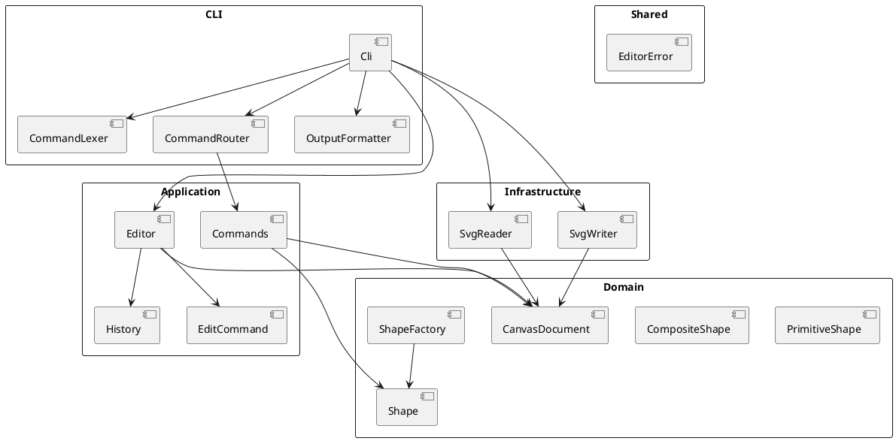

# 架构方案

## 1. 模块划分

| 模块 | 目录 | 职责 |
|---|---|---|
| 领域层 | `src/domain/` | 图形树、图形属性、容器关系、几何操作、文档状态和图形工厂；不依赖 CLI、文件系统或 XML 库。 |
| 应用层 | `src/application/` | 命令对象、命令执行、撤销重做、事务边界和文档生命周期。 |
| 基础设施层 | `src/infrastructure/` | SVG 文件的解析、序列化和文件读写。 |
| CLI 层 | `src/cli/` | 逐行读取、词法分析、命令分派、结果格式化及各层对象的组装。 |
| 共享模块 | `src/shared/` | 少量跨层复用的错误类型或公共类型，不包含业务操作。 |
| 测试与文档 | `tests/`、`doc/` | 单元测试、集成测试、测试素材及项目文档。 |

图形采用类层次组织，每个具体图形类独占一个同名文件。`Group` 与叶子图形提供统一操作入口。



## 2. 设计模式的选择

| 设计模式 | 代码落点 | 作用 |
|---|---|---|
| Command | `EditCommand` 及各编辑命令类 | 将一次编辑封装为独立对象，由 `Editor` 统一执行，并保证一次命令对应一个撤销单元。 |
| Composite | `Shape`、`PrimitiveShape`、`CompositeShape`、`Group` | 使容器和叶子图形通过相同接口完成移动、缩放、删除等操作；容器操作递归作用于后代。 |
| Factory | `ShapeFactory` | 集中创建内置图形，隔离具体图形类与命令层。 |
| Memento | `History` 与图形树的快照/克隆能力 | 保存文档状态，支持完整撤销重做和失败操作的状态回滚。 |

命令名到命令实现、图形类型名到具体图形类的分派分别只允许出现在 `CommandRouter` 和 `ShapeFactory` 中。这两个位置作为阶段一已有的集中分派点，后续插件化时再替换。

## 3. 依赖方向规则

```text
CLI ─────────────► Application ─────► Domain
 │                                      ▲
 ├──────────────► Infrastructure ──────┘
 │
 └──────────────► Shared ◄──── Application
                            ◄──── Infrastructure
                            ◄──── Domain
```

允许的依赖关系如下：

| 来源 | 可以依赖 | 理由 |
|---|---|---|
| `shared` | 无项目内模块 | 保持为最底层的少量公共定义。 |
| `domain` | `shared` | 领域模型只使用公共错误或类型，不感知外部技术。 |
| `application` | `domain`、`shared` | 命令和编辑流程建立在领域模型之上。 |
| `infrastructure` | `domain`、`shared` | SVG I/O 负责在文件格式与领域模型之间转换。 |
| `cli` | `application`、`infrastructure`、`shared` | CLI 是组合入口，负责连接命令执行与文件 I/O。 |

禁止 `domain` 依赖 `application`、`infrastructure` 或 `cli`；禁止 `application` 直接依赖终端、文件系统或具体 SVG 解析库；禁止 `infrastructure` 依赖 CLI 输出。违反这些方向的依赖均视为待处理项。

## 4. 变化点假设

| 变化点 | 预留方式或决定 |
|---|---|
| 新增图形类型 | 通过 `ShapeFactory` 和图形多态扩展。阶段一不引入插件接口，`box` 继续作为未知类型处理。 |
| 命令语法或命令集合变化 | 词法分析、命令分派和命令实现分别隔离，可在不修改领域模型的情况下扩展。 |
| SVG 文件格式或解析库变化 | 具体文件处理集中在基础设施层，领域层只处理图形树和属性。 |
| 撤销重做策略变化 | `Editor` 与 `History` 隔离历史管理，文档通过克隆能力提供稳定快照。 |
