# 第一部分：VSCode 插件实践

## 1. 安装/启动步骤

扩展源码位于 `vscode-svg/`目录。前置条件是 VSCode 1.96 或更高版本，以及可用的 Node.js 与 npm。

先在扩展目录内安装依赖并构建：

```bash
cd vscode-svg
npm ci
npm run compile
```

启动扩展有两种方式。

**方式一：开发调试**

1. 用 VSCode 打开 `vscode-svg` 目录。
2. 按 `F5`，VSCode 会打开一个新的 **Extension Development Host** 窗口，扩展自动在该窗口中加载。

**方式二：打包安装**

在 `vscode-svg` 目录运行以下命令：

```bash
npm run package
code --install-extension vscode-svg-navigator-0.1.0.vsix
```

`npm run package` 把扩展源代码打包成 `vscode-svg-navigator-0.1.0.vsix`，第二条命令把它装进本机 VSCode；也可在扩展面板右上角 `...` 中选择“Install from VSIX...”手动安装。

**如何确认已启动**

- 扩展在打开任意 `.svg` 文件（或工作区含有 `.svg`）时会自动激活，无需手动开启。
- 启动后可看到 Explorer 中 `.svg` 文件名右侧出现 `[]` 徽标。
- 打开 SVG 文本编辑器后，Outline 视图会显示元素层级，点击节点自动定位到源码。

## 2. 运行效果与异常输入

#### 运行效果

实例 SVG 文件见 `vscode-svg/samples/demo.svg`。

Explorer 中只有 `.svg` 文件显示 `[]`；普通文件与目录不显示徽标。

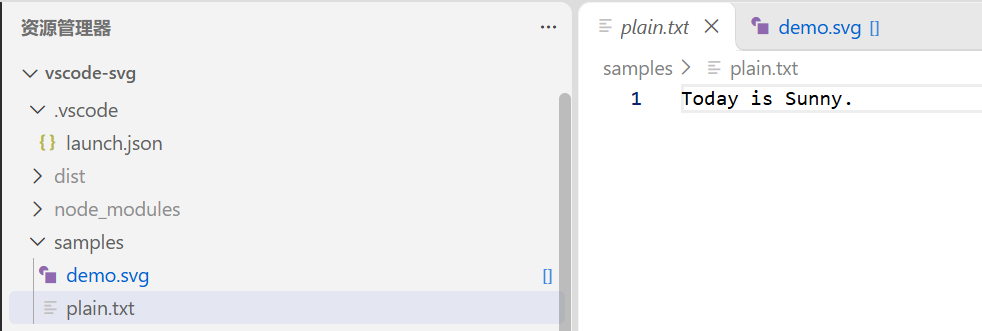

Outline 展示 SVG 文件节点之间的嵌套关系，有 id 的节点显示 `标签名#id`，无 id 的 `text` 节点只显示标签名；选择 `rect#start` 后，自动定位到对应源码。

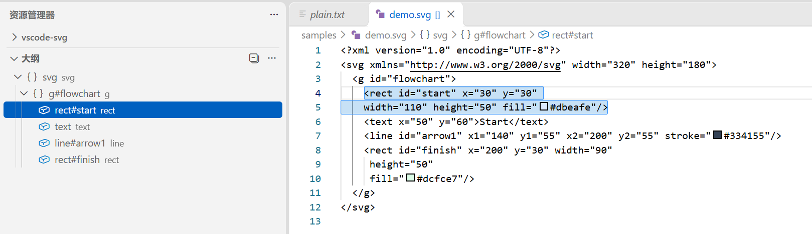

#### 异常输入

SVG 输入异常时，解析器 `vscode-svg/src/svgOutlineParser.ts` 的 `parseSvgOutline()` 用 `try/catch` 包住整段解析，任何不完整或非法结构都返回空数组（大纲清空），不向外抛出异常；输入恢复合法后，VSCode 会重新调用 provider，大纲自动恢复。

删去`g`的右边标签：

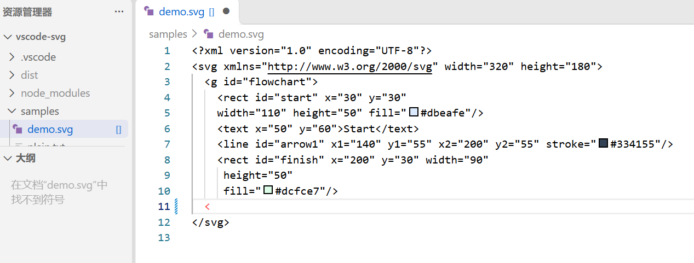

非法嵌套：

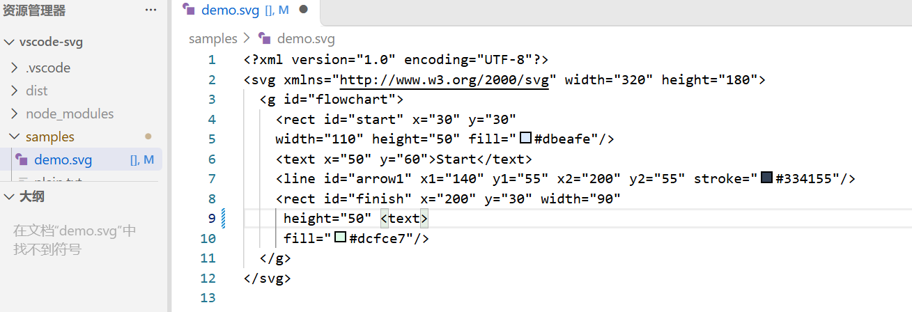

## 3. VSCode 与插件的职责，以及注册与调用功能过程

### 3.1 职责划分

- **VSCode**：提供 Extension API 与运行时；定义插件必须实现的“宿主接口”（`FileDecorationProvider`、`DocumentSymbolProvider` 等）；决定功能的触发时机与界面呈现；负责大纲树的构建、点击定位、文档变更后的刷新，以及调用时的取消与生命周期管理。
- **插件**：在 `activate` 中实例化并注册 provider，实现宿主接口、返回数据；不直接操作界面，仅通过返回值表达“要显示什么”。

这是一个由宿主（VSCode）掌控的**反向控制（IoC）**关系：插件注册功能，VSCode 在需要时回调，插件不主动进行界面绘制。

### 3.2 注册过程

激活入口 `vscode-svg/src/extension.ts` 在 `activate` 中完成注册：

```ts
export function activate(context: vscode.ExtensionContext): void {
  const decorationProvider = new SvgFileDecorationProvider();
  const outlineHighlighter = new SvgOutlineHighlighter();
  const symbols = vscode.languages.registerDocumentSymbolProvider(
    { language: "svg", scheme: "file" },
    new SvgDocumentSymbolProvider(),
    { label: "SVG elements" },
  );
  const decorations = vscode.window.registerFileDecorationProvider(
    decorationProvider,
  );
  const watcher = vscode.workspace.createFileSystemWatcher("**/*.svg");
  const refresh = vscode.window.createOutputChannel("SVG file decorations");

  context.subscriptions.push(
    symbols,
    decorations,
    watcher,
    refresh,
    watcher.onDidCreate(() => {
      decorationProvider.refresh();
      refresh.appendLine("SVG decoration refreshed");
    }),
    watcher.onDidChange(() => {
      decorationProvider.refresh();
      refresh.appendLine("SVG decoration refreshed");
    }),
    watcher.onDidDelete(() => {
      decorationProvider.refresh();
      refresh.appendLine("SVG decoration refreshed");
    }),
    decorationProvider,
    outlineHighlighter,
  );
}
```

- `registerFileDecorationProvider(provider)`：把文件装饰 provider 交给 VSCode，返回值是 `Disposable`。
- `registerDocumentSymbolProvider(selector, provider, meta)`：把大纲 provider 绑定到 SVG 文档，选择器为 `{ language: "svg", scheme: "file" }`。
- `createFileSystemWatcher("**/*.svg")`：监听 `.svg` 的新增/修改/删除，变化时调用 `decorationProvider.refresh()` 让 VSCode 重新查询，并写入输出通道 `SVG file decorations`。
- `SvgOutlineHighlighter`：监听编辑器选中变化，为点击大纲定位到的源码范围叠加蓝色高亮。
- `context.subscriptions.push(...)`：把上述 `Disposable` 与 `SvgFileDecorationProvider`、`SvgOutlineHighlighter` 一并登记，扩展卸载/停用时由 VSCode 统一释放。

文件装饰和大纲 provider 通过上述 API **以代码方式注册**，因此 `package.json` 的 `contributes` 中无需声明任何命令，只声明 `svg` 语言（`extensions: [".svg"]`），使 `.svg` 文件以 svg 语言打开，命中大纲选择器。

### 3.3 调用过程

注册完成后，插件不会再主动执行操作。实际功能由 VSCode 在需要时发起调用，插件仅负责返回数据，VSCode 依据返回值完成显示。以下按“调用时机、传入参数、返回值、VSCode行为”四个方面进行说明：

**1. 文件标记**

- 调用时机：资源管理器渲染某个文件或文件夹时。
- 传入参数：`provideFileDecoration(uri)`，其中 `uri` 为当前待渲染的资源。
- 返回值：返回 `FileDecoration`（包含徽标文本 `"[]"` 与提示语），或返回 `undefined`，表示该资源不附加标记。
- VSCode行为：将 `[]` 渲染在文件名右侧。

**2. 大纲**

- 调用时机：打开匹配 `.svg` 的文档/文档内容变更时。
- 传入参数：`provideDocumentSymbols(document)`，其中 `document` 为当前打开的文档。
- 返回值：返回 `DocumentSymbol` 数组，构成一棵符号树，每个节点包含显示名称及在文档中的位置范围。
- VSCode行为：将返回值呈现为大纲视图。
  - 点击定位：点击节点时，VSCode 依据节点自带的位置范围跳转并选中相应源码；跳转逻辑由 VSCode 实现，插件无需处理。
  - 自动更新：文档变更后，VSCode 会重新发起调用，大纲随之刷新，同样由 VSCode 自动完成。

下图展示了**插件在 `activate` 中注册各 provider，此后由 VSCode 在相应时机调用并依据返回值渲染界面**的全过程。

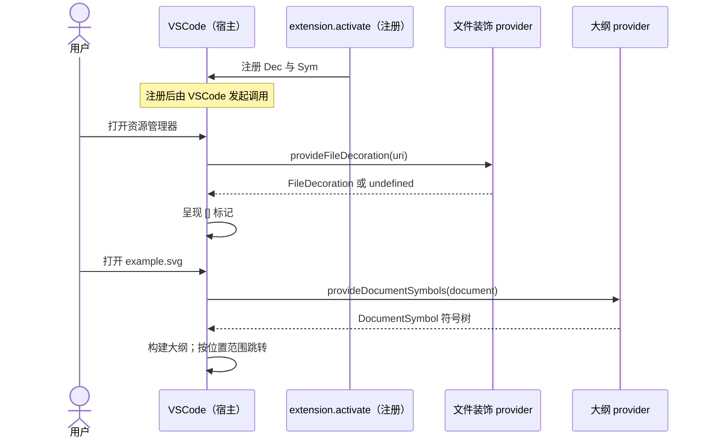

## 4. 文件装饰与经典 Decorator、Adaptor 模式的对应关系与差异

在正式比较之前，先介绍一下 VSCode 插件在接口、对象组合、调用关系三个层面的实现机制：

### 4.1 接口

接口按来源分为两组：一组由宿主（VSCode）规定，插件必须实现，否则宿主不会调用它；另一组由插件自己定义，用于把与 VSCode 无关的逻辑隔离出来。两组接口之间由 provider 类连接，provider 按宿主要求实现前一类接口，在内部则把工作转交给插件自身实现的那套逻辑。

以文件标记功能对应的代码为例：

（1）宿主（VSCode）定义的接口与数据类型，插件必须实现或返回：

```ts
interface FileDecorationProvider {
  provideFileDecoration(
    uri: Uri,
    token: CancellationToken,
  ): ProviderResult<FileDecoration>;
}
interface FileDecoration {
  badge?: string;
  tooltip?: string;
  color?: ThemeColor;
  propagate?: boolean;
}
```

说明：

- `FileDecorationProvider`：VSCode 要求实现的“文件装饰”接口。VSCode 显示某个文件时会调用 `provideFileDecoration(uri)`，并把该文件的 `uri` 传进来。
- `FileDecoration`：标记的内容本身，是一份纯数据。`badge` 是要显示在文件名右侧的文字（本插件为 `[]`），`tooltip` 是鼠标悬浮时的提示。

（2）插件自定义、与宿主无关的逻辑：

```ts
// svgFileDecorationPolicy.ts
export function isSvgDecorationCandidate(path: string): boolean {
  return path.toLowerCase().endsWith(".svg");
}

export function shouldDecorateSvg(path: string, isDirectory: boolean): boolean {
  return !isDirectory && isSvgDecorationCandidate(path);
}
```

以上两个纯函数的参数与返回值只用到 `string` 与 `boolean`，刻意不引用 VSCode 的类型（如 `vscode.Uri`、`vscode.FileType`），保证“是否加徽标”的判定逻辑可以脱离宿主环境独立编译与测试。

### 4.2 对象组合与委托

对象组合指一个类不靠继承，而是在内部**直接放入另一个对象**，把工作**交给**它（或交给一个模块的函数）完成而形成的组合关系。

如下列代码所示，`SvgFileDecorationProvider` 内部引入了一个 `vscode.EventEmitter` 对象（字段 `changeEmitter`），把它暴露为 `onDidChangeFileDecorations`；`refresh()` 通过 `changeEmitter.fire(undefined)` 通知 VSCode 重新查询装饰：

```ts
export class SvgFileDecorationProvider
implements vscode.FileDecorationProvider {
  private readonly changeEmitter =
    new vscode.EventEmitter<vscode.Uri | vscode.Uri[] | undefined>();
  public readonly onDidChangeFileDecorations = this.changeEmitter.event;

  public refresh(): void {
    this.changeEmitter.fire(undefined);
  }

  public async provideFileDecoration(uri: vscode.Uri) {
    if (!isSvgDecorationCandidate(uri.path)) {
      return undefined;
    }

    let isDirectory = false;
    try {
      const metadata = await vscode.workspace.fs.stat(uri);
      isDirectory = (metadata.type & vscode.FileType.Directory) !== 0;
    } catch {
      return undefined;
    }

    if (!shouldDecorateSvg(uri.path, isDirectory)) {
      return undefined;
    }

    return {
      badge: "[]",
      tooltip: "SVG file",
      color: new vscode.ThemeColor("charts.blue"),
    };
  }
}
```

`SvgFileDecorationProvider` 本身只负责“对外”的部分：按宿主要求实现 `FileDecorationProvider` 接口，并在被调用时把“是否加徽标”的判断交给 `svgFileDecorationPolicy.ts` 的 `isSvgDecorationCandidate` / `shouldDecorateSvg`（这里是调用模块函数，属于方法调用/委托，而不是把被调对象保存为字段）。

### 4.3 调用关系

调用关系分两个阶段。

**注册阶段**（只发生一次，在 `activate` 中）：`extension.activate` 调用注册 API，把 provider 交给 VSCode；注册 API 返回 `Disposable`，用于注销。

**运行阶段**（反复发生）：VSCode 在需要时**回调** provider，provider 再调用核心逻辑（指插件自定义的、与宿主无关的纯函数，如 `svgFileDecorationPolicy.ts` 的 `shouldDecorateSvg`），核心逻辑返回数据，数据沿原路回传，最终由 VSCode 决定如何显示。也就是说，**宿主是调用方，provider 是被调用方**；provider 只把请求转交给各自的核心逻辑，而核心逻辑不依赖宿主，因此依赖是单向的。

### 4.4 与经典 Decorator 的对应关系与差异

**经典 Decorator** 让**装饰者类与被装饰类实现同一个接口**，并且**装饰者把被装饰对象保存为自己的一个字段**。装饰者在实现接口方法时，先执行自己那部分附加处理，再调用所持有的被装饰对象的同名方法，把请求交给它（即“委托”）。由于装饰者自身也实现了同一接口，它可以同样被另一个装饰者持有，从而形成多层装饰链；调用最外层时，请求会逐层向内传递，直到最里面的原始对象。这样便能在不修改原始对象所属类的前提下，为它动态叠加功能。

#### 对应关系

- **意图**：Decorator 是“在不修改被装饰对象所属类的前提下为它附加职责”；文件装饰是“在不修改文件名与文件内容的前提下为文件附加显示信息（`[]` 徽标）”。两者都是附加信息而不侵入对象本身。
- **被装饰对象**：Decorator 中被装饰的原始对象，对应到文件装饰里是被装饰的**文件**，即 `provideFileDecoration` 收到的 `uri`。
- **附加物**：Decorator 附加的是一个实现同接口的装饰者对象；文件装饰附加的是一份装饰数据 `FileDecoration`（含 `badge`、`tooltip` 等字段）。
- **生效方式**：Decorator 把装饰者放到原对象的调用位置上生效；文件装饰把 `FileDecoration` 交给 VSCode，由 VSCode 在渲染资源时呈现。

#### 差异

| 对比点 | 经典 Decorator | 文件装饰 |
|---|---|---|
| 附加的是什么 | 一个**对象**：装饰者实现与被装饰者相同的接口，并持有被装饰者 | 一份**数据**：`FileDecoration`（只含 `badge`、`tooltip` 等字段），不包含被装饰的文件 |
| 与被装饰对象是否同接口 | 是（装饰者与被装饰者实现同一接口） | 否 |
| 如何组合 | 装饰者在构造时持有被装饰对象，调用时沿链**向内委托** | 装饰规则不与文件绑定；由 VSCode 在渲染时查询 provider 取得数据 |
| 能否叠加 | 可多层嵌套，逐层增强 | 同一文件只有一个徽标，不存在多层与逐层委托 |
| 规则写在哪 | 增强逻辑写在装饰者类里 | 装饰规则写在 provider 及其调用的纯函数中，与渲染无关（本插件即 `SvgFileDecorationProvider` + `svgFileDecorationPolicy.ts`） |

#### 结论

文件装饰在意图上与 Decorator 一致——不侵入被装饰对象就附加信息。但在结构上与经典装饰者不同：它返回的是一份说明性数据，既不与被装饰对象实现同一接口，也不向被装饰对象委托调用。

因此我们可以说，文件装饰是 Decorator “加职责”思想的一种**数据化/注解化**版本（徽标相当于给文件贴了一条注解）。

### 4.5 与 Adaptor 的对应关系与差异

**对象适配器**让**适配器类实现目标接口（`Target`）**，并且**适配器把被适配对象（`Adaptee`）保存为自己的一个字段**。适配器在实现目标接口的方法时，先做必要的类型与数据转换，再调用所持有的 `Adaptee` 完成实际工作（即“委托”）。这样调用方（`Client`）只依赖 `Target` 接口，而不需要知道 `Adaptee` 的存在。

#### 对应关系

- **意图**：Adaptor 让调用方只依赖一个稳定接口，实际工作交给另一个部件完成；而文件装饰让 VSCode 只依赖 `FileDecorationProvider`，具体工作交给内部对象完成。两者都实现了调用方与实现方的解耦。
- **调用方**：Adaptor 的调用方可以是任何依赖 `Target` 的代码；文件装饰里对应 VSCode。
- **目标接口**：Adaptor 的 `Target` 是为调用方定义的接口；文件装饰里对应宿主定义的 `FileDecorationProvider`。
- **被适配者**：Adaptor 的 `Adaptee` 是实际工作的既有部件；文件装饰里对应插件自身定义的与宿主无关的逻辑（`svgFileDecorationPolicy.ts` 的纯函数）。
- **适配产物**：Adaptor 适配后仍能通过方法调用代理被适配者的能力；文件装饰产出的则是一份装饰数据 `FileDecoration`（`badge`、`tooltip` 等）。

#### 差异

| 对比点 | 经典 Adaptor | 文件装饰机制 |
|---|---|---|
| 目的 | 复用**已存在**的类：把它的接口转换成调用方需要的接口 | 宿主预先定义接口，供实现者接入 |
| 转换对象 | 转换接口与方法，适配器仍以方法调用的方式代理能力 | 转换**数据**：把判定结果包装成 `FileDecoration` 返回 |
| 适配方向 | 旧接口 → 新接口 | 实现者内部逻辑 → 宿主接口 |
| 接入方式 | 由构造期组合或外部装配把适配器交给调用方 | 实现者须在扩展激活时主动注册 provider |
| 组合结构 | 可链式组合、层层嵌套 | 机制不规定链式组合；同一资源只取一个装饰结果 |

#### 结论

文件装饰机制与对象适配器的一致之处在于“调用方只依赖稳定接口、实际工作由实现方完成”，实现调用方与实现方的解耦；不同之处在于，它并非为复用既有类而设，接入方式与适配产物也与经典 Adaptor 不同。

## 5. Phase 1 解析、模型、遍历代码的复用评估

按解析、模型、遍历三方面对各自模块进行评估：

### 5.1 解析

| 模块 | 功能 | 能否复用 | 原因 |
|---|---|---|---|
| `CommandLexer` | 把命令行切词，处理引号、转义与注释行 | 可直接复用 | 命令语法在第二阶段不变；切词只关心 token 的形态，与“由谁处理命令”无关，与扩展点机制正交，可原样作为内核的命令行前端 |
| `CommandParser` | 把 token 归约为 `name + args`，并特判 `create … in <id>` | 可复用，但需要进行改造 | “token → 命令名 + 参数”的归约可保留；但 `in` 子句的特判把命令语义写进了内核。第二阶段要求命令名、参数规则与 `help` 文案由命令插件提供，故须剥离这处命令专有知识，parser 只产出通用命令结构，`in` 的处理移入 `create` 命令插件 |
| `SvgReader`（基于 `@xmldom/xmldom`） | 解析 SVG 为 `CanvasDocument`：严格校验、自动补 id、收集警告、按路径读取 | 可复用，但须依赖倒置 | DOM 遍历骨架、id 补全与警告机制正是第二阶段所需的读入能力；但当前它写死依赖 `ShapeFactory`，须改为依赖 `ShapeProvider` 注册表，才能读回 `box`（带 `data-kind="box"`）并按约定降级为普通 `g`。另外它直接用 Node `fs` 读取文件，`dir` 所需的目录访问适配器无法复用这条路径，需要进行改写 |
| `CommandRouter` | 按 `command.name` 分发到各命令处理 | 不可复用，须替换为命令注册表 | 内核“按命令名枚举”，导致新增 `stats` / `dir` 都必须改内核，违反 OCP。第二阶段要求内核经由注册表分发、命令名与参数规则由插件提供，故须改造为 `Command` 注册表；各 `*Command` 类“编辑意图”的数据结构保留为内核命令（如 `create`）的实现 |

### 5.2 模型

| 模块 | 职责 | 能否复用 | 原因 |
|---|---|---|---|
| `Shape` / `CompositeShape` / `Rect` / `Circle` / `Group` 等 | 编辑用领域模型：几何、属性、`move`/`scale`、`typeName` | 可复用（作为内核公开的领域抽象） | 第二阶段明确“插件可依赖内核公开的领域抽象”，这些类正是内核要暴露给插件的稳定模型。六个图形保持行为不变，`box` 作为 `CompositeShape` 的插件子类型接入。 |
| `getTreeSummary()` | 树上每行的摘要文本 | 可复用 | 每行摘要仍由图形自身给出；树标签（`*`、`(box)`）由 `TreeDecorator` 在行尾追加，与之职责不重叠。 |
| `ShapeFactory` | 按类型名创建与读回图形（`isSupported` / `create` / `createFromAttributes`） | 不可复用，须替换为扩展点 | 三个方法都写死了类型。第二阶段要求以 `ShapeProvider` 为扩展点、内核不依赖具体图形，故须改造为注册表加默认内置实现。 |

### 5.3 遍历

| 模块 | 职责 | 能否复用 | 原因 |
|---|---|---|---|
| `OutputFormatter.appendTree` / `formatTreeLine` | 对领域树做保序深度优先遍历并输出文本行 | 可复用，但须改造 | 遍历骨架可直接沿用；但渲染器须与标签解耦，为 `TreeDecorator` 预留“行尾追加标签”的挂点，并保证无标签时输出逐字节不变 |
| `CanvasDocument` 的父子索引 / `collectSubtree` | 容器索引、按 id 取父/子、子树收集 | 可直接复用 | `shapesById` / `parentsById`、`rootShapes`、`getParent` / `getChildren` 为 `stats` 的有序遍历、`box` 的 id 冲突检查、以及“一次 `set` 是一个 undo 单元”提供现成能力；`collectSubtree` 可直接用于 box 新增子树（`-rect`、`-label`）的 id 唯一性校验与撤销快照 |

# 第二部分：CLI 插件式重构

## 重构前后模块依赖图

下图只表达模块之间的主要编译期依赖和调用关系，不展开每个类的全部成员，依赖箭头表示左侧模块依赖右侧模块。

### 重构前

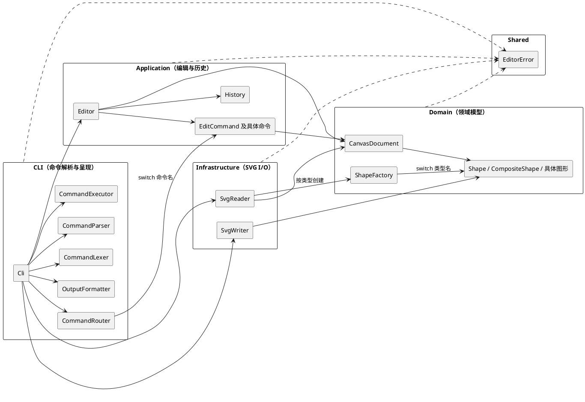

重构前，`CommandRouter` 通过命令名 `switch` 直接认识具体命令，`ShapeFactory` 通过类型名 `switch` 直接认识具体图形。新增命令或图形需要修改这些枚举点；可选能力也没有独立的装配边界。

### 重构后

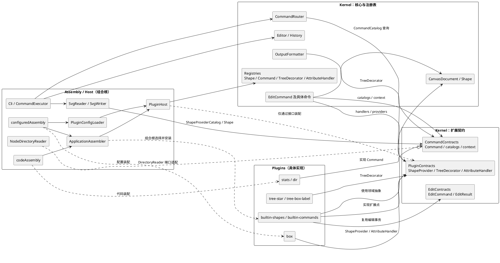

重构后，内核只依赖固定接口和公开领域抽象：`CommandRouter` 从`CommandCatalog` 查询命令，`CreateCommand` 和 `SvgReader` 通过`ShapeProviderCatalog` 获取图形 provider，`SetCommand` 通过`AttributeHandlerCatalog` 选择属性处理器，`OutputFormatter` 通过 `TreeDecorator` 追加标签。具体实现统一在 `PluginHost` 校验后注册，代码装配与配置装配都位于组合根，与内核分开。

## 扩展点清单

四个扩展点接口都定义在内核一侧：`ShapeProvider`、`TreeDecorator`、`AttributeHandler` 在 `src/kernel/PluginContracts.ts`，`Command` 在 `src/kernel/CommandContracts.ts`。内核只依赖这几个接口与目录接口（`ShapeProviderCatalog`、`CommandCatalog`、`AttributeHandlerCatalog` 以及 `TreeDecorator[]`），不引用任何具体实现；插件则以类实现接口，在 `activate` 中经 `PluginActivationContext` 的 `registerShape` / `registerCommand` / `registerTreeDecorator` / `registerAttributeHandler` 提交注册。正因如此，即使一个可选插件都不装，框架仍能启动，行为退回 Phase 1。

下面先说明四个扩展点共用的注册校验规则，再逐个展开。

**共同注册错误**（`src/bootstrap/PluginHost.ts` 的 `install()`）

插件的注册先写入本插件的暂存区（`PluginActivationContext` 的四个 `register*`），`activate` 返回后再由宿主依次校验清单一致性与重复名，全部通过才并入已安装集合，任一步失败都会返回 `PluginInstallResult`（`{ ok: false, code, message }`）并丢弃该插件的全部暂存注册，**不抛出异常**：

| 情形 | `code` | 消息 | 触发时机 |
|---|---|---|---|
| `contributes` 与 `activate` 实际注册的类别/名称集合不一致 | `manifest-mismatch` | `plugin manifest mismatch: <name> (declared: …, registered: …)` | `install()` 中 `activate` 返回后 |
| 同类注册名与已安装插件或本插件暂存注册重复 | `duplicate-registration` | `duplicate registration: <category>/<name>` | 同上，清单校验之后 |
| `activate()` 抛错 | `activation-failed` | `plugin failed to activate: <name> (<reason>)` | `install()` 调用 `activate` 时 |

其中 `<category>` 取 `shapes` / `commands` / `decorators` / `attributes`；`<name>` 为各实现的 `name` 字段（`shapes` 的重复检查同时比较 `name` 与 `typeName`）。装配处（`createPluginApplication`）把失败消息以 `error: <message>` 记入启动信息，该插件不安装、其余插件继续加载。

### 1. `ShapeProvider`

#### 接口

`ShapeProvider` 定义在 `src/kernel/PluginContracts.ts`，包含以下成员：

* `name` ：注册名；
* `typeName` ：命令行里写的类型名，`create` 按它查找 provider；
* `restorePriority` ：读回匹配优先级，数值越大越优先；
* `canRestore(elementName, attributes): boolean` ：认领某个 SVG 元素，返回 `false` 表示不匹配；
* `create(id, args): Shape` ：按命令行参数新建图形；
* `restore(id, attributes, textContent): Shape` ：从 SVG 元素读回图形；
* `finalizeRestored?(shape): void` ：读回后的校验/补全钩子，可选。

#### 职责

承载「一种图形类型」。每一种图形都由一个 `ShapeProvider` 实例代表；内核本身无需知道任何具体图形，有关它的全部知识——认领哪些 SVG 元素、怎么新建、怎么从文件读回——都来自对应的 provider。

插件实现 `ShapeProvider` 并注册后，对应的图形就自动获得「新建、从文件读回」两种能力，写出文件由图形自身负责，全程无需修改内核代码。

#### 内核调用它的位置

新建图形时，`src/application/commands/CreateCommand.ts` 的 `execute(document)` 先调 `this.shapes.getForCreate(shapeType)`（`ShapeProviderCatalog`）找到 provider，再调它的 `create(id, params)`；取不到则抛 `unknown shape type: <type> (is the plugin loaded?)`。

从文件读回时，`src/infrastructure/SvgReader.ts` 的 `appendChildren()` 与 `collectExplicitIds()` 先调 `this.shapeProviders.getForRestore(type, attributes)` 找到 provider，再调 `provider.restore(id, attributes, textContent)`；若返回的图形 `instanceof CompositeShape`（即容器），则继续递归其子元素；最后调 `provider.finalizeRestored?.(shape)`。

写出文件时，`src/infrastructure/SvgWriter.ts` 的 `serializeShape()` **不再查询 provider**，元素名与属性直接取自图形自身：`shape.serializationName`、`shape.getShowAttributes()` 与 `shape.getSerializationAttributes()`。

如果多个 provider 都能认领同一个元素，就由 `src/kernel/Registries.ts` 的 `ShapeProviderRegistry.getForRestore()` 决定用哪一个：对 `canRestore()` 为真的 provider 按 `restorePriority` 降序取第一个。

#### 现有的实现

六个内置图形都写成了 provider，详见 `src/plugins/builtin-shapes/index.ts`：

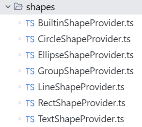

它们共用一个 `BuiltinShapeProvider` 实现，由 `builtinShapesPlugin.activate()` 注册、`createBasePluginHost()` 安装。`box`（`src/plugins/shape-box/index.ts`）也是实现之一，`restorePriority` 为 `100`，`canRestore` 认领 `<g data-kind="box">`。

#### 禁用可选扩展时的行为

默认装配只提供上述六个内置 provider，且六种图形的创建、读回、序列化输出与 Phase 1 完全一致。

此时执行 `create box ...`，会由 `CreateCommand.execute` 抛出 `error: unknown shape type: box (is the plugin loaded?)`；`SvgReader` 遇到认领不上的元素直接跳过，并输出 `warning: skipped unsupported element <<type>>`。

#### 违反契约时的报错

除共同的注册错误外，还有以下几种违反契约的情况：

- `create()` 收到非法参数：抛 `EditorError`（例如 `invalid rect parameters`、`invalid box parameters`），经 `create` 命令显示为 `error: <message>`。
- `restore()` 抛错：由 `SvgReader.read()` 统一转为 `EditorError`（`cannot read file: <path>`），整个读入失败，原文档不变。
- `finalizeRestored()` 抛错（例如已装 `box` 插件，但读入的 box 缺少必要子部件）：同样使整个读入失败，`read` 显示 `error: cannot read file: <path>`，原文档不变。
- `canRestore()` 对某元素全部返回 `false`：该元素被跳过并给出告警，不算错误。
- 多个 provider 的 `name` 或 `typeName` 重复：在注册阶段被 `PluginHost` 拒绝，插件不安装。

### 2. `Command`

#### 接口

`Command` 定义在 `src/kernel/CommandContracts.ts`，具有三个成员：

* `name` ：命令名，同时用作注册名；
* `help` ：`CommandHelp`，形如 `{ section, sectionOrder, line, order }`；`section` 决定这条命令归到 `help` 的哪一组，`sectionOrder` / `order` 决定组内外的排列，`line` 是 `help` 里显示的那一行用法文本；
* `execute(args, context): string` ：执行命令并返回要打印的文本。`args` 为 `readonly CommandToken[]`，每个 `CommandToken` 带 `value` 与 `quoted`；`context` 为 `CommandExecutionContext`，说明内核向插件开放的能力集合（`editor`、`formatter`、`svg`、`shapes`、`attributes`、`commands`、`treeDecorators`、`directories`、`workingDirectory`）。

#### 职责

承载「一条命令」。内核无需认识任何具体命令，一条命令接受什么参数、执行什么逻辑、在 `help` 里怎么显示，全部由对应的插件决定，内核只负责把用户输入交给它。

#### 内核调用它的位置

执行一行命令时，`src/cli/CommandRouter.ts` 的 `execute(command)` 先经 `this.commands.get(command.name)`（`CommandCatalog`，按插件的 `name` 查找）取出插件，再调用 `implementation.execute(command.args, this.context)`——`CommandRouter` 持有装配处传入的 `CommandExecutionContext`，把它作为第二个实参交给插件，由插件返回要打印的文本。

生成 `help` 文案时，`src/cli/OutputFormatter.ts` 的 `help(commands)` 先按 `help.sectionOrder` 与 `help.order` 排序，再按各命令的 `help.section` 分组、以 `help.line` 为内容拼出文案。

读入一行输入时（到达 `CommandRouter` 之前），`src/cli/CommandExecutor.ts` 的 `execute(line)` 先用 `CommandLexer.tokenize()` 切词、再由 `CommandParser.parse()` 归约为 `ParsedCommand`，转交 `CommandRouter.execute(command)`；最外层 `src/cli/Cli.ts` 的 `start()` 按行读入后依次调用。

#### 现有的实现

十九条内置命令均已改为插件，详见 `src/plugins/builtin-commands/index.ts`：

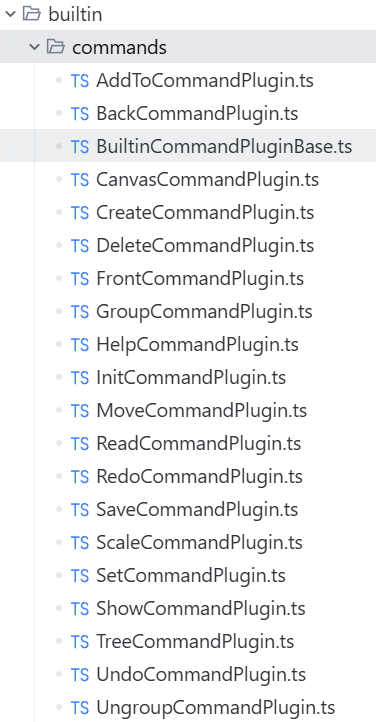

每条内置命令都继承 `DeferredBuiltinCommand`（实现 `Command`），由 `builtinCommandsPlugin.activate()` 注册、`createBasePluginHost()` 安装；实际逻辑在 `BuiltinCommandService` 中。`stats`（`src/plugins/command-stats/index.ts`）与 `dir`（`src/plugins/command-dir/index.ts`）也是实现。

#### 禁用可选扩展时的行为

默认装配只提供上述十九条内置命令，它们的行为、输出与 Phase 1 完全一致。

如果执行 `stats` 或 `dir`，会由 `CommandRouter.execute` 抛出 `EditorError`（`unknown command: stats`），显示为 `error: unknown command: stats`；`help` 由 `CommandCatalog.all()` 生成，因此也不会列出这两条命令。

#### 违反契约时的报错

以下错误都在 `src/cli/CommandExecutor.ts` 的 `execute(line)` 中统一处理， `EditorError` 会统一捕获为 `error: <message>` 返回：

- 命令未注册：`CommandRouter.execute` 经 `this.commands.get(name)` 取不到插件（声明了 `help` 却没有对应实现，或实现没进 `help`），抛 `EditorError`（`unknown command: <name>`），显示为 `error: unknown command: <name>`。
- `execute()` 收到非法参数：插件自身校验后抛 `EditorError`（例如 `invalid rect parameters`），显示为 `error: <message>`。
- 未打开文档就执行编辑命令：`Editor.execute` 的 `requireDocument` 抛 `EditorError`（`no document. use 'init' or 'read' first`）。
- 编辑事务失败（目标 id 不存在、id 重复、容器非法等）：由 `EditCommand.requireShape` 与 `CanvasDocument` 抛 `EditorError`（如 `no such shape: <id>`、`id already exists: <id>`、`not a container: <id>`），文档保持命令执行前的状态。
- 文件读写失败：`read` / `save` 中由 `SvgReader` / `SvgWriter` 抛 `EditorError`（`cannot read file: <path>` / `cannot write file: <path>`）。

若抛出的是其他未预料的异常，即属违反接口约定，`CommandExecutor` 不再改写消息，异常直接冒泡。

### 3. `TreeDecorator`

#### 接口

`TreeDecorator` 定义在 `src/kernel/PluginContracts.ts`，具有两个成员：

* `name` ：注册名；
* `decorate(context): readonly string[]` ：返回该行要追加的一到多个标签，空数组表示不加标签。参数 `TreeDecorationContext` 提供当前行对应的 `document`、`shape`（根 `svg` 行时为 `undefined`）、`isRoot`、`savedDocument` 与 `saveSequence`。

#### 职责

承载「结构树某一行末尾的标签」。内核只负责把行本身渲染出来，是否加标签、加什么内容，由各 decorator 决定。

插件实现 `TreeDecorator` 并注册后，`tree` 的每一行（含根 `svg` 行）都会自动带上对应的标签，而无需修改渲染器与内核代码。

#### 内核调用它的位置

渲染 `tree` 时，`src/cli/OutputFormatter.ts` 的 `tree()` 接收装配处传入的 `decorators`（`buildPluginApplication` 中的 `decorators.all()`，含根 `svg` 行与 `rootId` 子树的根行），再逐行调用同文件的 `appendDecorations(line, decorators, context)`。`appendDecorations` 用 `decorators.flatMap(d => d.decorate(context))` 收集标签，全部为空则原样返回 `line`，否则以两个空格把标签接在行尾（`${line}  ${labels.join(" ")}`）。

#### 现有的实现

目前有两个标签插件：

* `tree-star`（`src/plugins/tree-star/index.ts`）：decorator 名 `modified-star`，为存在未保存变化的行追加 `*`，根行与所有祖先容器行同样标记；
* `tree-box-label`（`src/plugins/tree-box-label/index.ts`）：decorator 名 `box-type-label`，为 `box` 容器行追加 `(box)`。

标签自身维护的状态（clean snapshot、已观察到的保存序号）保存在 decorator 实例字段中，不使用模块级变量。

#### 禁用可选扩展时的行为

默认装配不注册任何标签。`tree` 的每一行都只由 `formatTreeLine()` 渲染出行本身，`appendDecorations` 在标签为空时原样返回传入的 `line`，输出与 Phase 1 逐字节一致。

#### 违反契约时的报错

`decorate()` 可能抛错：`src/cli/OutputFormatter.ts` 的 `appendDecorations` 正在逐行调用各 decorator，出现异常会中断本轮渲染，`tree` 命令整体失败。属于 `EditorError` 时统一捕获显示为 `error: <message>`，其余异常原样冒泡。

### 4. `AttributeHandler`

#### 接口

`AttributeHandler` 定义在 `src/kernel/PluginContracts.ts`，具有三个成员：

* `name` ：注册名；
* `handles(shape, attribute): boolean` ：判断自己是否负责这次处理，不修改文档状态；
* `apply(context): AttributeHandlerResult | void` ：执行修改。`AttributeApplyContext` 提供 `document`、`shape`、`attribute` 与 `value`，处理器通过 `context.shape` 拿到目标图形并调用其公开方法，从而修改相关子部件。

`AttributeHandlerResult`（同文件）含三个字段：`message`（正常执行时的输出）、`undoMessage` / `redoMessage`（可选，`undo` / `redo` 时的输出）。处理器返回该结果时，`SetCommand` 把它记入 `EditResult`，`OutputFormatter.formatSetResult` 按方向打印 `<typeName>#<id> <message>`（例如 `box#n1 fill propagated to n1-rect`、`label updated: "处理数据 v2"`、`label restored: "开始"`）；返回 `void` 时沿用默认文案 `<typeName>#<id> updated: <attr>=<value>`。

#### 职责

承载「某个属性在某类图形上的含义」。如果某类图形的某个属性要求具有特殊语义，可以通过插件实现 `AttributeHandler` ，此后对这类图形 `set` 对应属性时就会自动改由 `AttributeHandler` 处理，而不必扩张内核的属性白名单。

#### 内核调用它的位置

执行 `set` 指令时，`src/application/commands/SetCommand.ts` 的 `execute(document)` 先用 `requireShape` 定位目标图形，再调装配时注入的 `AttributeHandlerCatalog.findApplicable(shape, attribute)`：

* 命中两个及以上：抛错 `EditorError`（`conflicting attribute handlers for <id>/<attr>: <names>`），此时尚未修改文档；
* 命中一个：调用该处理器的 `apply({ document, shape, attribute, value })`，其返回值（若为 `AttributeHandlerResult`）决定 `set` 的输出文案；
* 一个都没有：回落到 Phase 1 的规则，由 `shape.setAttribute(attribute, value)` 处理。

「一次 `set` 就是一个 undo 单元」由 `src/application/Editor.ts` 的 `execute(command)` 保证：命令执行前执行 `document.clone()` 进行克隆，命令成功后再克隆一次并记入 `History`，这样哪怕处理器一次改了多个子部件，一次 `undo` 也能整体退回，同理 `redo` 也能整体重做。

#### 现有的实现

`box` 插件提供了 `box-attributes` 处理器（`src/plugins/shape-box/index.ts`）：命中 `Box` 的 `fill` 与 `label`，转调 `Box.setFill` / `Box.setLabel`，由这两个方法定位并修改内部子部件（`#<id>-rect`、`#<id>-label`）。

#### 禁用可选扩展时的行为

默认装配不注册任何处理器。`set` 一律走 `shape.setAttribute`，与 Phase 1 行为相同：仅支持修改普通图形原本允许修改的属性（`fill`、`stroke`、`stroke-width`、各类型的几何属性，以及文本元素的 `text`）；未定义的属性抛 `error: unknown attribute: <attr>`（`Shape.unknownAttribute`）。

#### 违反契约时的报错

- 一次 `set` 命中两个及以上处理器：`src/application/commands/SetCommand.ts` 的 `execute(document)` 在修改文档**之前**拒绝，抛 `EditorError`（`conflicting attribute handlers for <id>/<attr>: <names>`），`set` 显示为 `error: ...`，文档保持不变。
- 处理器收到自己不负责的属性：自行抛 `EditorError`（例如 `unknown attribute: <attr>`），以免掩盖错误或重复修改。
- `handles()` 或 `apply()` 抛错：异常经 `SetCommand` 回传到 `src/application/Editor.ts` 的 `execute(command)`，它把文档替换回执行前的 before 快照后再原样抛出，若异常属于 `EditorError` 则显示为 `error: <message>`，否则冒泡。因为 `History.record` 只在成功后调用，这次失败不会进入 undo/redo 栈，撤销与重做仍停留在命令执行前的状态。

## 插件装配

插件有两种可选的装配方式：默认启动走**代码装配**，`--config <path>` 走**配置装配**，另有 `--builtins-only` 只装配内置插件，用于对照 Phase 1 行为。两条路径的组装结果与运行期行为一致，差别只在于「插件从哪来、清单由谁声明」。

### 1. 代码装配

**含义**：可选插件在源码里被直接引用，装配关系写在代码中、编译期就已确定；增删插件必须改代码并重新编译。

**如何装配**：「装配一个新插件」需要四步（以新增一条 `export` 命令为例）：

**（1）新建插件目录与实现文件** `src/plugins/command-export/index.ts`：实现内核定义的扩展点接口，并导出插件对象。

```ts
import {
  type Command, type CommandExecutionContext, type CommandToken,
} from "../../kernel/CommandContracts.js";
import { type PluginDefinition } from "../../kernel/PluginContracts.js";

// 实现对应扩展点接口
class ExportCommand implements Command {...}

// 创建插件对象
export const commandExportPlugin: PluginDefinition = {...};

export default commandExportPlugin;
```

**（2）在同目录放 `package.json`**，声明插件名与清单：

```json
{
  "name": "@svgframe/plugin-command-export",
  "version": "1.0.0",
  "private": true,
  "type": "module",
  "contributes": { "commands": ["export"] }
}
```

**（3）在 `src/bootstrap/codeAssembly.ts` 顶部 `import` 该插件对象，再加进 `CODE_PLUGINS`**：

```ts
import { commandExportPlugin } from "../plugins/command-export/index.js";

export const CODE_PLUGINS: readonly PluginDefinition[] = [
  commandExportPlugin...
];
```

**（4）运行与构建**：`npm run cli`即可看到新命令已进入 `help`，插件装配成功。

**装配原理：**在 `src/bootstrap/codeAssembly.ts` 的常量数组 `CODE_PLUGINS` 中列出需要装配的插件，再交给通用组装函数 `createPluginApplication`：

```ts
// src/bootstrap/codeAssembly.ts
export const CODE_PLUGINS: readonly PluginDefinition[] = [
  commandStatsPlugin,
  commandDirPlugin,
  shapeBoxPlugin,
  shapeArrowPlugin,
  treeBoxLabelPlugin,
  treeStarPlugin,
];

export function createCodeAssembledApplication(
  options: Omit<PluginApplicationOptions, "plugins" | "pluginOptions"> = {},
): PluginApplication {
  return createPluginApplication({ ...options, plugins: CODE_PLUGINS });
}
```

`createPluginApplication`（`src/bootstrap/ApplicationAssembler.ts`）会先安装内置插件，再把数组里的插件逐个安装，最终组装出 `PluginApplication`，完成装配。

### 2. 配置装配

**含义**：装配关系由一份 JSON 配置文件在运行时给出，主程序不引用任何具体插件，因此不改代码就能增减插件。

**如何装配**：同一份插件源码接入配置装配时，**插件目录、实现写法与 `package.json` 与代码装配完全相同**，区别只在后面两步：

**（3）让插件模块可被解析**：修改配置文件，在 `plugins` 中新增一个元素：

```json
{ "module": "./dist/plugins/command-export/index.js" }
```

**（4）构建并启动**：

```bash
npm run build
npm run cli:config
```

此后工作由 `createConfiguredApplication(path)`（`src/bootstrap/configuredAssembly.ts`）完成：先安装内置插件，再读配置文件，按数组顺序逐项解析模块、动态加载并安装，最后与代码装配走同一套装配流程。

#### 配置文件

配置文件是一份随项目放置的 JSON 文件，用来在运行时声明「要装配哪些插件」。通过配置装配路径「增删插件」时，就需要修改这份文件。配置文件的路径可由启动参数指定（`--config <path>`）。

**配置文件格式**：顶层是一个 JSON 对象，唯一字段 `plugins` 是数组，每个元素描述一个插件：

```json
{
  "plugins": [
    {
      "module": "./dist/plugins/command-stats/index.js"
    },
    {
      "module": "./dist/plugins/tree-star/index.js",
      "enabled": true,
      "options": {
        "reply": "option received"
      }
    }
  ]
}
```

`plugins` 元素字段：

| 字段 | 是否必需 | 类型 | 含义 |
|---|---|---|---|
| `module` | 必需 | 非空字符串 | 模块名或路径。相对路径相对配置文件目录解析，包名走 Node 模块解析，可省略扩展名 |
| `enabled` | 可选 | 布尔，默认 `true` | 为 `false` 时该项在解析模块之前被跳过 |
| `options` | 可选 | 普通对象，默认 `{}` | 作为插件参数经 `PluginActivationContext.options` 传给插件 |

三个字段的类型或 `plugins` 的数组结构不合法时，整份配置视为非法，程序退回只装内置插件。

## `dir` 的目录访问接口与适配器模式说明
### 1. `dir` 的目录访问接口

与 `dir` 相关的接口与类共四处，逐一进行说明：

**（1）`DirectoryReader`——目录访问接口**（`src/kernel/CommandContracts.ts`）

```typescript
interface DirectoryReader {
  list(path: string): readonly DirectoryEntry[];
}
```

`DirectoryReader` 是内核对外提供的一个「读目录」能力接口。内核与 `dir` 命令都依赖且只依赖于它，于是「读目录」和「用哪种文件系统去读」分开了，底层能力的修改不会影响到内核。

**（2）`DirectoryEntry`——目录项数据**（`src/kernel/CommandContracts.ts`）

```typescript
interface DirectoryEntry {
  readonly name: string;
  readonly kind: "directory" | "file" | "symlink" | "other";
}
```

形如 `{ name, kind }`，其中 `kind` 取 `"directory" | "file" | "symlink" | "other"` 之一。

`DirectoryEntry` 把「一个目录项」归一化成内核可理解的数据，消除不同文件系统 API 的差异。

**（3）`NodeDirectoryReader`——把 Node 文件系统接入目录访问接口的适配器**（`src/infrastructure/NodeDirectoryReader.ts`）

实现 `DirectoryReader`。`list` 通过 `node:fs` 的 `readdirSync(path, { withFileTypes: true })` 读取目录，再用私有方法 `kindOf` 把每个 `Dirent` 的 `isDirectory` / `isSymbolicLink` / `isFile` 映射为对应的 `kind`，最终返回 `DirectoryEntry[]`。

**（4）`DirCommand`**（`src/plugins/command-dir/index.ts`）

实现 `dir` 命令。先校验参数（须为空，否则 `usage: dir`），再调用 `context.directories.list(context.workingDirectory)` 取回 `DirectoryEntry[]`，随后按「目录在前、文件在后、组内按名称升序」排序，按 `kind` 加 `[DIR]` / `[FILE]` / `[SYMLINK]` / `[OTHER]` 标记；空目录返回 `(empty directory)`，`list` 抛错时转为 `EditorError("cannot read directory: <path>")`。

`DirCommand` 依赖于 `DirectoryReader` 接口，不关心其具体实现。

### 2. 适配器模式是什么

适配器模式（Adapter Pattern）用于把一个类的接口转换成客户端所期望的另一个接口，使原本因接口不兼容而无法协作的两方能够一起工作。它通常包含四类角色：

- **Target（目标接口）**：客户端直接依赖的接口，定义客户端期望的调用方式；
- **Client（客户端）**：只通过 Target 调用功能的代码；
- **Adaptee（被适配者）**：已经存在、但接口不符合 Target 的类或子系统；
- **Adapter（适配器）**：实现 Target，并在内部把调用转接到 Adaptee，必要时做接口或数据转换。

按适配器与 Adaptee 的关系，常见两种形态：

- **对象适配器**：适配器持有 Adaptee 的实例，通过组合与委托调用它；
- **类适配器**：适配器通过继承 Adaptee 复用其实现（多见于支持多继承的语言）。

适配者模式的价值在于：客户端只依赖稳定的 Target，Adaptee 的替换不会波及客户端，符合依赖倒置与开闭原则。

### 3. `dir` 的接口与适配器模式各角色的对应关系

| 适配器模式角色 | `dir` 中的对应 | 说明 |
|---|---|---|
| Target（目标接口） | `DirectoryReader` | 内核与命令共同依赖的稳定接口 |
| Client（客户端） | `DirCommand` | 经 `CommandExecutionContext.directories` 调用 `list()` |
| Adaptee（被适配者） | `node:fs` 的 `readdirSync` 及其返回的 `Dirent[]` | 以系统调用为中心的 API，字段与判据都不同于领域模型 |
| Adapter（适配器） | `NodeDirectoryReader` | 实现 `DirectoryReader`，内部调用 `node:fs`，并把 `Dirent[]` 转成 `DirectoryEntry[]` |
| 适配产物 | `DirectoryEntry` | 转换得到的、内核可理解的数据 |

`dir` 接口与经典对象适配器还存在一定差异：经典对象适配器一般适配一个**既有对象**，把它保存为字段再委托调用；而此处被适配的是**模块函数 API**（`node:fs`），适配器以类实现 Target、直接在方法内调用模块函数，无需持有被适配对象。

## ADR

详见 `doc/adr/`下的三个文件：

- [ADR 0001：属性扩展点契约](adr/0001-属性扩展点契约.md)
- [ADR 0002：box 读回降级与最小不变量](adr/0002-box读回降级与最小不变量.md)
- [ADR 0003：modified-star 的 dirty 语义与传播](adr/0003-modified-star 的 dirty 语义与传播.md)

## 拓展任务

注册了一个新图形类型 `arrow`（箭头）。插件代码位于`src/plugins/shape-arrow/`，通过已有的 `ShapeProvider` 扩展点接入：

命令语法沿用 `line` 和 `circle` 的参数风格：

```text
create arrow <id> <x1> <y1> <x2> <y2> [stroke]
```

实际运行效果示例：

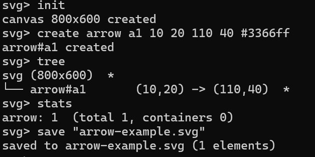

得到的文件内容：

```text
<?xml version="1.0" encoding="UTF-8"?>
<svg xmlns="http://www.w3.org/2000/svg" width="800" height="600" viewBox="0 0 800 600">
  <path id="a1" d="M 10 20 L 110 40 M 96.82099571871403 44.70678724331642 L 110 40 L 99.64506806470389 30.586425513367168" fill="none" stroke="#3366ff" data-kind="arrow" data-x1="10" data-y1="20" data-x2="110" data-y2="40"/>
</svg>
```

实现要点：

- `Arrow` 是叶子 `Shape`，支持通用的 `move`、`scale`、`set`、`delete`、undo/redo 和 `show`。
- 箭头序列化为单个 SVG `<path>`，箭头头部由起点、终点自动计算。
- 路径带有 `data-kind="arrow"` 和端点数据；安装插件时可完整读回。
- 未安装插件时，`create arrow` 返回未知图形错误，读取 arrow 的 `<path>`会按既有规则跳过并给出不支持元素警告。
- 提交代码已使用两种装配方式对 `Arrow` 进行装配：代码装配写入 `src/bootstrap/codeAssembly.ts`，配置装配写入`plugins.config.json`。

## 判据完成情况与证据

本节逐条对照 `phase_cli_2.md` 第二部分第 1—6 节的「判据」，给出实现位置、验证方式与证据（提交 + 文件）。判据中的「接入新插件的那次提交 `C`」指下表列出的提交；命令与测试均在仓库根目录执行，证据文件路径相对仓库根。

### 关键提交索引

| 提交 | 说明 |
|---|---|
| `097a4d0` | 完善 SVG 文件装饰边界与刷新 |
| `ea8a68c` | 建立四扩展点插件内核 |
| `575fcb2` | 生成插件重构首批指标 |
| `2fe3485` | 接入 `stats` 与 `dir` 命令插件 |
| `b363007` | 通过代码装配接入 `box` 插件 |
| `1cec103` | 通过配置装配接入 `box` 插件 |
| `6792314` | 对齐 `box` 插件与 Phase 1 语义 |
| `b3a7d70` | 并行接入 `modified-star` 与 `(box)` 标签 |
| `d0e247f` | 补充加载与命令测试 |
| `beffe8b` | 新增形状 `arrow` |

### 1. 四个扩展点（§1 判据）

| 判据 | 证据文件 | 验证方式 |
|---|---|---|
| 扩展点接口在内核一侧，内核只依赖接口、不依赖实现 | `src/kernel/PluginContracts.ts`（`ShapeProvider` / `TreeDecorator` / `AttributeHandler`）、`src/kernel/CommandContracts.ts`（`Command`、`DirectoryReader` 与各 Catalog）；调用位置见上文「扩展点清单」 | 查看提交 `ea8a68c`，接口只在 `src/kernel/`，`src/application`、`src/cli` 只引用接口与 Catalog |
| 插件以类或实例实现扩展点，不依赖内核内部实现与宿主装配模块 | `src/plugins/*/index.ts` | 查看代码：可选插件（`shape-box`、`shape-arrow`、`tree-star`、`tree-box-label`、`command-stats`、`command-dir`）只 `import` `src/kernel/` 契约与 `src/domain/` 公开模型，且彼此不互相引用（如 `tree-box-label` 用内核抽象的 `Shape.typeName` 判型而非 `import` `shape-box` 的 `Box`）；内置命令插件 `src/plugins/builtin-commands/BuiltinCommandService.ts` 属于标准库，按既有设计复用 `src/application/commands/*`，但同样不引用任何插件或装配模块 |
| 禁用插件仍能启动，默认内置命令与六图形输出不变 | `tests/cli/Phase1Baseline.test.ts`、`tests/cli/Acceptance.test.ts` | 运行：`npm run cli:builtins`；`npm test` |

### 2. 命令插件 `stats` / `dir`（§2.3 判据）

| 判据 | 证据文件 | 验证方式 |
|---|---|---|
| `stats`、`dir` 各自独立于内置命令表，可单独启停；已装进 `help`，未装报 `unknown command` | `src/plugins/command-stats/index.ts`、`src/plugins/command-dir/index.ts` | `tests/plugins/CommandPlugins.test.ts`（`is absent when its plugin is not loaded`）；`tests/bootstrap/PluginConfigLoader.test.ts`（非法配置用例） |
| 接入 `dir` 不改内核与既有插件；两种装配用同一命令实现与同一目录接口 | — | `git diff --name-status 2fe3485^ 2fe3485 -- src/kernel src/plugins/builtin-shapes src/plugins/builtin-commands` 输出为空 |
| `dir` 逻辑可用测试替身独立测试（混合项、空目录、隐藏项、读取失败、稳定排序），并用临时目录验证真实适配器 | `tests/plugins/CommandPlugins.test.ts`（`FakeDirectoryReader`、`works through the real filesystem adapter`） | `npm test`（`dir command plugin` 用例组） |
| 未初始化文档时 `dir` 可用；有文档时执行成功/失败均不改文档与 undo/redo | 同上（`reports adapter failure without requiring a document`、`keeps document and history unchanged`） | 同上 |
| 两种装配对同一固定目录执行 `dir` 输出逐字节一致，且目录内容不变 | `scripts/verify-transcripts.mjs`、`doc/transcript/cli-2-commands.expected.txt` | `npm run transcripts`（`commands` 场景，含 `snapshotDirectory` 目录快照校验） |

### 3. 属性扩展点（§3.4 判据）

| 判据 | 证据文件 | 验证方式 |
|---|---|---|
| `set n1 fill` 改内部矩形、`set n1 label` 改内部文本，各自一个 undo 单元 | `src/plugins/shape-box/index.ts`、[ADR 0001](adr/0001-属性扩展点契约.md) | `tests/plugins/ShapeBox.test.ts`（`creates the documented subtree and creates undo units per property`） |
| 每条命令一次 `undo` 恢复、一次 `redo` 重做 | 同上 | 同上（含 `undo` / `redo` 断言） |
| 无处理器命中时，原有允许属性仍可改，未定义属性报错 | `src/application/commands/SetCommand.ts` | `tests/cli/Acceptance.test.ts`（`set child opacity 0.5` → `unknown attribute: opacity`） |
| 多处理器命中时行为符合 ADR，无未定义覆盖 | [ADR 0001](adr/0001-属性扩展点契约.md) | `tests/plugins/ShapeBox.test.ts`（`rejects conflicting handlers before mutation`） |
| 处理器部分修改后抛错时，文档与 undo/redo 回滚到命令前 | `src/application/Editor.ts` | `tests/plugins/ShapeBox.test.ts`（`rolls back partial handler changes and preserves prior history`） |

### 4. 图形插件 `box`（§4 判据）

| 判据 | 证据文件 | 验证方式 |
|---|---|---|
| 接入 `box` 的提交不改内核与既有插件 | — | `git diff --name-status b363007^ b363007`（只新增 `src/plugins/shape-box/*` + 一个装配文件 + 测试）；排除新插件包后内核与既有插件差异为空 |
| Phase 1 §6.1 会话装插件后完整复现 | `doc/transcript/cli-2-box.txt`、`cli-2-box.expected.txt`、[ADR 0002](adr/0002-box读回降级与最小不变量.md) | `tests/plugins/ShapeBox.test.ts`（`reproduces the Phase 1 section 6.1 box session`）；`npm run transcripts`（`box` 场景） |
| 插件测试独立运行，可用测试替身，不依赖其他插件 | `tests/plugins/ShapeBox.test.ts`（`namedAttributePlugin` 替身） | `npx vitest run tests/plugins/ShapeBox.test.ts` |
| 边界：id 冲突整条失败、缺件/错型/重复 id 读入拒绝、必要子部件不可删/移 | `tests/plugins/ShapeBox.test.ts` | 具体请见以下测试用例：`rejects id collisions...`、`round-trips data-kind and downgrades...`、`rejects incomplete, wrong-type, and duplicate-id box input atomically`、`rejects operations that would break required child invariants` |

### 5. 树标签插件（§5 判据）

| 判据 | 证据文件 | 验证方式 |
|---|---|---|
| 新增标签时内核与渲染器差异为 0 | `src/plugins/tree-star/index.ts`、`src/plugins/tree-box-label/index.ts` | `git diff --name-status b3a7d70^ b3a7d70 -- src/kernel src/plugins/builtin-shapes src/plugins/builtin-commands` 输出为空 |
| Phase 1 `tree` 基线（无标签）逐字节不变 | `tests/cli/Phase1Baseline.test.ts` | 见测试用例：`keeps the baseline tree unchanged when no decorators are loaded` |
| `modified-star` 状态机独立测试：编辑 → 保存 → 再编辑 → `undo` 回保存点，各分支覆盖 | [ADR 0003](adr/0003-modified-star 的 dirty 语义与传播.md) | `tests/plugins/TreeDecorators.test.ts`（前三个用例，含 `keeps decorator state per activation instead of module-global`） |

### 6. 两种装配方式（§6 判据）

| 判据 | 证据文件 | 验证方式 |
|---|---|---|
| 方式 A：只新增插件，只改一个顶层装配文件，不动内核/加载器/既有插件 | — | `git diff --name-status b363007^ b363007` |
| 方式 B：已有运行代码不改，仅新增插件与改配置 | — | `git diff --name-status 1cec103^ 1cec103`（只改配置与测试 fixtures） |
| 排除新插件包后，内核与既有插件差异为空 | — | `git diff --name-status <C>^ <C> -- src/kernel src/plugins/builtin-shapes src/plugins/builtin-commands`（`C` = `2fe3485` / `b3a7d70` / `b363007`，输出均为空） |
| 加载器独立性：不硬编码插件导入、名称映射或分支 | `src/bootstrap/PluginConfigLoader.ts` | `rg -n "import|require|switch" src/bootstrap`：该文件仅 `import` `node:fs` / `node:module` / `node:path` / `node:url` 与 `./PluginHost.js`，按模块名字符串解析 |
| 双装配一致性：同一输入会话两种方式输出逐字节相同 | `scripts/verify-transcripts.mjs`、`doc/transcript/cli-1.expected.txt`、`cli-2-box.expected.txt`、`cli-2-commands.expected.txt` | `npm run transcripts`（三场景，`Buffer.equals` 逐字节比较） |
| 基础兼容性：禁用新增插件后对照 `final` 输出一致 | `scripts/compare-final.mjs`、`doc/transcript/final-compat.json` | `npm run compare:final`（记录 `equal: true`、`bytes: 792`） |

### 证据文件说明

#### `doc/metrics/`

由 `scripts/generate-metrics.mjs`（`npm run metrics`）从 git 历史（`final..p2`）生成，脚本随仓库提交；依赖包与构建产物排除，VSCode 扩展也不纳入 CLI 指标。

| 文件           | 含义                                                         |
| -------------- | ------------------------------------------------------------ |
| `metrics.json` | 原始数据源（机器可读）。含 `baseRef`（`final`）、`targetRef`（`p2`）、`targetLabel`（`p2`）与 `categories`（`kernel` / `assembly` / `plugin`）；`base` 与 `target` 两组各自按类别的 `files` / `lines` / `complexity` 聚合与 `total`；以及逐文件明细（`path` / `category` / `responsibility` / `lines` / `complexity`）。 |
| `summary.md`   | 由 `metrics.json` 派生的汇总表：kernel / assembly / plugin 三类的文件数、行数、圈复杂度及 `final` → `p2` 增量，并附统计口径与方法说明。 |
| `files.md`     | 由 `metrics.json` 派生的文件清单：逐文件的变更状态（`M` 基线已有 / `A` 新增）、行数、圈复杂度、类别与职责。 |

#### `doc/transcript/`

供双装配一致性（`scripts/verify-transcripts.mjs`）与 `final` 兼容性（`scripts/compare-final.mjs`）比较使用；输入文件只含命令与注释，不含 `svg>` 提示符或示例输出，期望输出单独保存。

| 文件                                                 | 含义                                                         |
| ---------------------------------------------------- | ------------------------------------------------------------ |
| `cli-1.txt`                                          | Phase 1 基础会话的**输入**脚本（命令与注释）。               |
| `cli-1.expected.txt`                                 | `cli-1.txt` 的**期望输出**（含提示符），用于与代码装配 / 配置装配的运行结果逐字节比对；基础兼容性比较时对照 `final`。 |
| `cli-2-box.txt` / `cli-2-box.expected.txt`           | Phase 1 §6.1 的 `box` 会话输入与期望输出。                   |
| `cli-2-commands.txt` / `cli-2-commands.expected.txt` | 含 `stats`、`dir` 的新增命令会话输入与期望输出（`dir` 在 `init` 之前执行）。 |
| `final-compat.json`                                  | `compare-final.mjs` 产出的兼容性证据：`baseRef`（`final`）、`currentMode`（`--builtins-only`）、`equal`、`bytes` 等。 |
| `transcript-cwd/`                                    | `dir` 场景的**固定工作目录**，内容不随运行改变：`alpha.svg`、`beta.txt`、`.hidden.txt`（隐藏项）为普通文件，`docs/`、`plugins/` 为两个子目录（各含 `.gitkeep` 以便纳入版本库）。 |

**重新生成 / 校验**：

```bash
npm run metrics              # 生成 doc/metrics/*
npm run transcripts          # 校验 doc/transcript/*.expected.txt（加 -- --update 可重写期望文件）
npm run compare:final        # 生成 doc/transcript/final-compat.json
```

### 人工运行截图

运行 `npm run transcripts`：

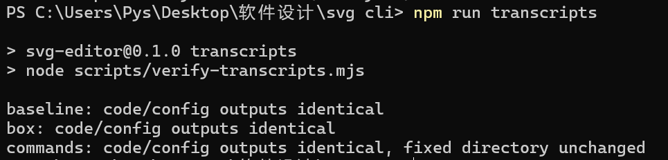

运行 `npm run compare:final`：

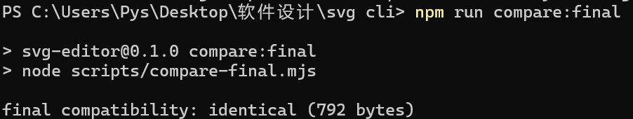

## 与 AI 协作时的检查与修正

### 协作与检查方式

每实现一个新功能后，会人工检查运行效果、代码架构、代码改动等是否符合预期。如果发现问题，会立马让 AI 进行修正，这也是 git 提交历史中出现 fix 的原因：

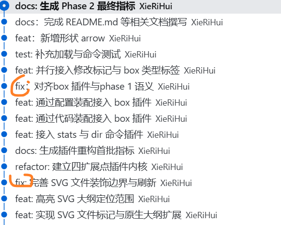

### 主要检查点与修正

| 检查点 | 发现的问题 | 修正落点（及对应的提交） |
|---|---|---|
| 插件是否只依赖内核契约、彼此不耦合 | 树标签插件 `import` 另一插件的 `Box` 类并用 `instanceof` 判型，形成插件间耦合 | 改用内核契约暴露的 `Shape.typeName` 判型，删除该 `import`——「**并行接入修改标记与 box 类型标签**」 |
| `box` 插件是否与 Phase 1 语义一致 | 与 Phase 1 §6.1 会话逐字节对照，读回降级与最小不变量存在偏差 | 对齐语义并补充回归——「**对齐 box 插件与 Phase 1 语义**」 |
| VSCode 文件装饰的边界与刷新 | 工作区仅含 SVG、以及文件增删时徽标刷新边界不完备 | 收窄装饰范围、补齐增/删/改刷新——「**完善 SVG 文件装饰边界与刷新**」 |
| 加载器失败路径与命令插件独立启停 | 缺少「插件未加载即报 `unknown command`」与非法配置的测试 | 补齐加载与命令用例——「**补充加载与命令测试**」 |

