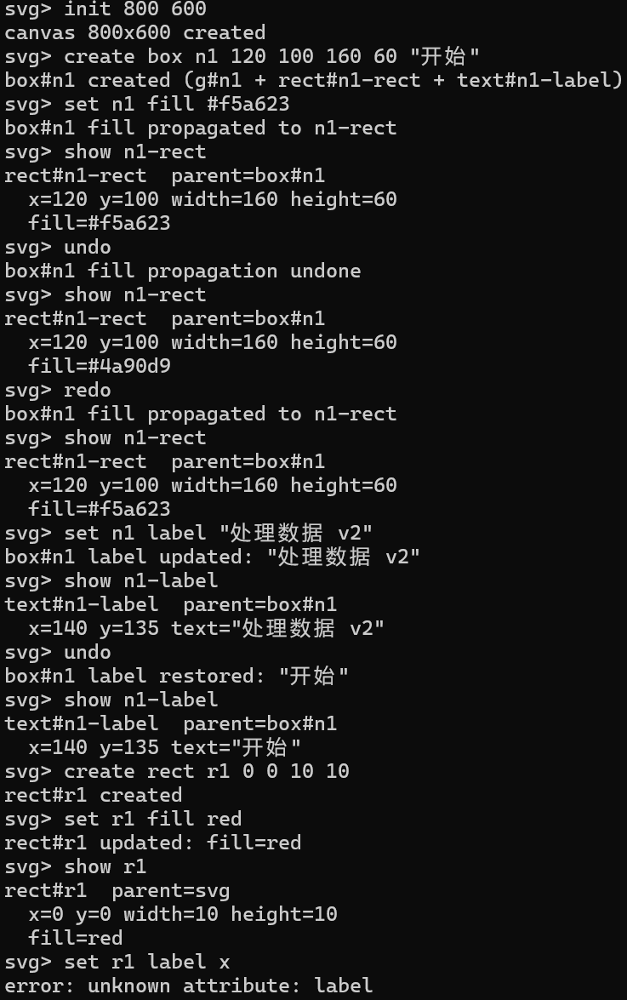

# ADR 0001：属性扩展点契约

## 状态

已接受。

## 背景

Phase 1 的 `set` 直接调用 `Shape.setAttribute`，属性白名单由各图形自身维护。这种做法对普通叶子图形足够，但 `box` 的 `fill` 需要修改内部矩形、`label`需要修改内部文本，若在 `SetCommand` 中判断 `box`，或把 `label` 加进内核白名单，内核就会反向依赖具体插件语义。

为此，引入属性扩展点 `AttributeHandler`，把属性的处理行为从内核中剥离出来交给插件。其接口与调用契约如下：

## 决策

### 1. 接口与目标图形的获取

内核接口位于 `src/kernel/PluginContracts.ts`：

```ts
interface AttributeHandler {
  readonly name: string;
  handles(shape: Shape, attribute: string): boolean;
  apply(context: AttributeApplyContext): AttributeHandlerResult | void;
}

interface AttributeApplyContext {
  readonly document: CanvasDocument;
  readonly shape: Shape;
  readonly attribute: string;
  readonly value: string;
}

interface AttributeHandlerResult {
  readonly message: string;
  readonly undoMessage?: string;
  readonly redoMessage?: string;
}
```

相对草拟的初始接口（`handles(shapeId, attr)` / `apply(shapeId, attr, value)`只传 id 字符串），这里作出两处调整：

- 执行 `set` 指令时 `SetCommand` 会用 `requireShape` 定位到目标图形，而后直接把 `Shape` 对象传给`handles` 与 `apply` ，避免处理器触碰 `CanvasDocument` 的私有索引。
- `apply` 的返回值由 `void` 扩展为 `AttributeHandlerResult | void`：需要自定义输出文案时返回该结果，否则返回 `void` 走默认文案（见下文「处理器的输出文案」）。

#### 如何判断图形类型/修改子部件

- `handles(shape, attribute)` 只做判断、不修改文档。处理器根据传入的 `shape` 通过
  `instanceof` 关键字判断图形类型，再判断属性名是否归自己负责。
- `apply(context)` 通过 `context.shape` 拿到目标图形，借助图形自身的方法完成修改。以 box 为例（`src/plugins/shape-box/index.ts`）：

```ts
public handles(shape: Shape, attribute: string): boolean {
  return shape instanceof Box &&
    (attribute === "fill" || attribute === "label");
}

public apply(
  context: AttributeApplyContext,
): AttributeHandlerResult {
  if (!(context.shape instanceof Box)) {
    throw new EditorError("box attribute handler received another shape");
  }
  if (context.attribute === "fill") {
    context.shape.setFill(context.value);
    return {
      message: `fill propagated to ${context.shape.id}-rect`,
      undoMessage: "fill propagation undone",
      redoMessage: `fill propagated to ${context.shape.id}-rect`,
    };
  }
  if (context.attribute === "label") {
    const previous = context.shape.label ?? "";
    context.shape.setLabel(context.value);
    return {
      message: `label updated: "${context.value}"`,
      undoMessage: `label restored: "${previous}"`,
      redoMessage: `label updated: "${context.value}"`,
    };
  }
  throw new EditorError(`unknown attribute: ${context.attribute}`);
}
```

处理器调用 `apply` 后，`Box.setFill` / `Box.setLabel`（`src/plugins/shape-box/Box.ts`）内部再去定位并修改对应的子部件。

#### 处理器的输出文案

处理器可返回 `AttributeHandlerResult` 自定义 `set` 的输出：`SetCommand` 把它原样写入 `EditResult`，`OutputFormatter.formatSetResult`（`src/cli/OutputFormatter.ts`）按当前方向取用对应字段并打印为 `<typeName>#<id> <message>`；对应方向的字段缺省时，回落到默认文案 `<typeName>#<id> updated: <attr>=<value>`。

| 方向 | 取用字段 | 示例输出 |
|---|---|---|
| 正常 | `message` | `box#n1 fill propagated to n1-rect` |
| `undo` | `undoMessage` | `box#n1 fill propagation undone` |
| `redo` | `redoMessage` | `box#n1 fill propagated to n1-rect` |

`undo` / `redo` 直接复用历史条目中保存的 `EditResult`（`Editor.undo` / `redo`），故文案与首次执行一致；例中 `label` 的 `undoMessage` 在 `apply` 时记下改前的文本，因此 `undo` 显示 `label restored: "开始"`。

### 2. 多个处理器同时命中处理规则

`SetCommand.execute`（`src/application/commands/SetCommand.ts`）中通过 `registry.findApplicable(shape, attribute)`（`src/kernel/Registries.ts` 中
`AttributeHandlerRegistry.findApplicable`，返回全部命中的处理器）裁决：

1. 0 个命中：执行  `shape.setAttribute(attribute, value)` 默认路径。
2. 1 个命中：执行处理器的 `apply`。
3. 2 个及以上命中：抛 `EditorError`：`conflicting attribute handlers for <id>/<attr>: <names>`，其中 `<names>`为按注册顺序排列的命中处理器名。

即当有多个处理器同时命中时明确拒绝。

### 3. 如何保证一次 `set` 是一个 undo 单元

处理器自身不记录历史，`set` 由 `Editor.execute`（`src/application/Editor.ts`）统一执行：

- 执行前 `const before = document.clone()` 克隆整份文档；
- 命令执行成功后再次克隆 `const after = document.clone()`，并把 `{ before, after, result }`记为一条 `HistoryEntry`；
- 即使处理器（例如 box 的 `fill`）改动了多个子部件，所有改动都视为同一次 `set`；
- `undo` 执行时会把文档整体替换为 `before` 快照，`redo` 则是整体替换为 `after` 快照。

因为“多处子部件修改”不会拆成多条历史项，所以执行 `undo` 会整体恢复，执行 `redo` 会整体重做。

### 4. 失败回滚与历史保持

`handles` 或 `apply` 抛错时，异常会一路冒泡被 `Editor.execute` 捕捉，并执行：`this.currentDocument = before`，把文档恢复为命令执行前的快照，再原样抛出异常。因为 `History.record` 只在成功路径上调用，失败时不会写入 undo/redo 栈，故栈仍停留在命令执行前的状态，先前已有的 `undo` / `redo` 记录不受影响。

## 验证

`tests/plugins/ShapeBox.test.ts` 按上述契约覆盖：

- 创建 box 子树后，`set n1 fill #f5a623` 与 `set n1 label "处理数据 v2"` 各构成一个 undo 单元，一次 `undo` / `redo` 即可往返。
- 普通 `rect fill` 无专用处理器时走 `shape.setAttribute(attribute, value)` 默认路径。
- 追加一个同样命中 `box` 的 `fill` 的处理器，确认 `set` 在修改前报 `error: conflicting attribute handlers for n1/fill: ...`，且文档无变化。
- 测试替身先修改组内两个矩形的 `fill` 再抛错，确认两处改动均被回滚，且先前的 redo 历史仍在（`undo` 仍能撤销更早的 `rect#b` 创建）。

### 人工验证

启动 `npm run cli`（装配所有插件），依次执行：

```text
init 800 600
create box n1 120 100 160 60 "开始"
set n1 fill #f5a623
show n1-rect
undo
show n1-rect
redo
show n1-rect
set n1 label "处理数据 v2"
show n1-label
undo
show n1-label
create rect r1 0 0 10 10
set r1 fill red
show r1
set r1 label x
```

输出：



从输出中可看出`set` 的 `fill` 与 `label` 各构成一个 undo 单元，一次 `undo`/`redo` 即可往返；普通图形仍走默认路径，未定义属性仍报错。

> 冲突（多个处理器命中）与「部分修改后抛错回滚」两条边界需要测试替身插件，无人工复现成本较大，其验证以 `tests/plugins/ShapeBox.test.ts` 为准

## 后果

- 优点：内核不出现 `box/fill/label` 分支；扩展点可独立测试；冲突与失败边界统一。
- 代价：冲突策略较保守，未来组合同属性处理器需要显式升级接口并另立 ADR。
