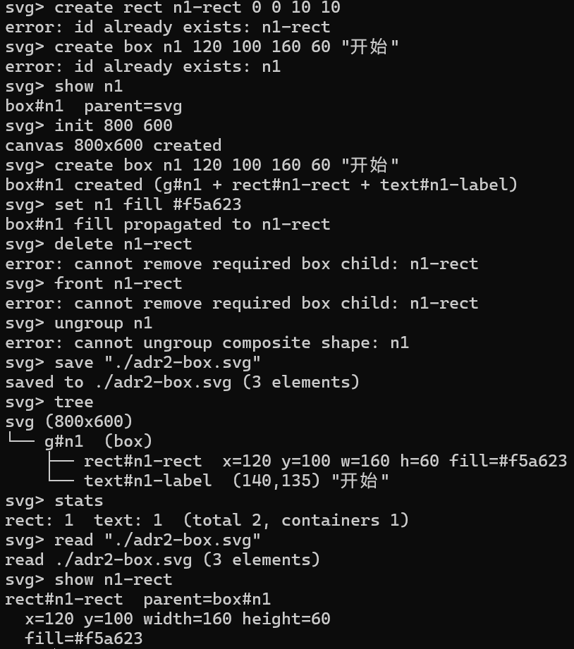
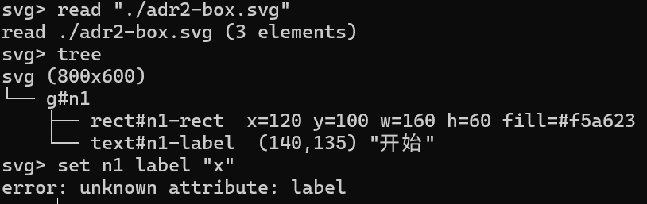
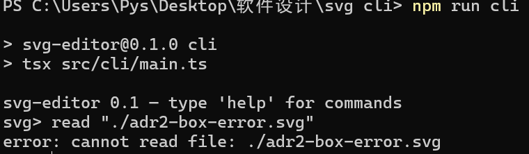

# ADR 0002：box 读回降级与最小不变量

## 状态

已接受。

## 背景

`box`（带标题的矩形框）是流程图/框图的基本构件，内部由矩形与文本两个子部件组成：

```text
create box n1 120 100 160 60 "开始"
```

- 作为 **Composite**，它与普通叶子图形一样可 `move`/`delete`/`set`，与 `g` 一样支持 `in`、 `group`，并可继续嵌套 `box`；
- 它是由**插件提供的图形类型**，内核不认识 `box`，只按 `ShapeProvider` 接口消费。

序列化时它退化为普通 SVG（`<g data-kind="box">` + `<rect>` + `<text>`），因此必须在两种环境下都表现正确：

- 安装 box 插件：凭 `data-kind="box"` 还原为不可拆散的 Box；
- 未安装 box 插件：作为普通 SVG 分组读入，功能不损、语义降级。

这使得 box 依赖一组隐含不变量：容器内必须恰好有一个矩形与一个文本子部件。一旦它们被普通命令删除或移出，或读入的文件本身破坏该结构，就会出现不完整的领域对象。

本 ADR 记录由此产生的三处取舍——**子部件 id 派生规则**、**读回降级策略**、**`fill`/`label` 属性处理契约**；其中属性处理契约的完整接口、多处理器冲突规则与事务边界见 ADR 0001，此处只记录与 box 结构相关的部分。

## 决策

### 创建与序列化

`create box <id> <x> <y> <w> <h> <label>` 创建一个 `box`：

- `<id>`：`g#<id>` 容器；
- `<id>-rect`：内部矩形；
- `<id>-label`：内部文本。

序列化形式为：

```xml
<g id="n1" data-kind="box">
  <rect id="n1-rect" .../>
  <text id="n1-label" ...>...</text>
</g>
```

### 子部件 id 派生规则

两个必要子部件的 id 由容器 id **派生**，固定为 `<id>-rect` 与 `<id>-label`：

- 好处是读回时可按固定规则直接定位必要子部件，`finalizeRestored` 不必依赖任何
  额外元数据；也让“同一个 box 的对外 id 与内部 id 一眼可辨”。
- 代价是子部件 id 占用全局命名空间，因此创建前必须对**整个新增子树**（含`-rect`、`-label` 及后续嵌套图形）与文档已有 id 做全局唯一性检查；任何冲突都会使整条命令失败。
- 同理，读回时如果出现重复 id ，直接拒绝整个读入。

### 属性处理契约：fill 与 label

`box` 的 `fill`、`label` 不属于内核白名单属性，其语义完全由插件提供：

- box 插件注册 `AttributeHandler`（`handles` 命中 `Box` 的 `fill`／`label`），`SetCommand` 经处理器注册表选中后调用其 `apply`；无处理器命中时回落到 Phase 1 的 `shape.setAttribute`。
- **权威值保存在子部件**：`fill` 的权威值取自 `rect#<id>-rect` 的 `fill` 属性，`label` 的权威值取自 `text#<id>-label` 的文本内容；`<g>` 外壳只保留 `data-kind="box"`，不重复保存这两个值。
- 处理器只调用 `Box` 提供的公共方法 `setFill` / `setLabel`修改对应子部件；图形字段保持封装。
- **一次 `set` 是一个 undo 单元**：`Editor.execute` 在执行前后各克隆一次整份文档，即使处理器同时改动多个子部件，`undo`／`redo` 也整体回退／重做。
- 处理器部分修改后抛错时，`Editor.execute` 把文档恢复为执行前的快照并原样抛出错误；修改失败不写入历史，undo/redo 保持命令执行前的状态。

完整接口、多处理器命中时的冲突规则与事务实现见 ADR 0001。

### 读回降级策略

#### 安装插件时读回

Box provider 的匹配条件是：

```text
elementName === "g" && attributes["data-kind"] === "box"
```

其恢复优先级高于内置 `g` provider。读完直接子节点后调用 `finalizeRestored`，要求存在且仅存在：

- 一个 `rect#<id>-rect`；
- 一个 `text#<id>-label`；
- 全局 id 唯一。

允许附加嵌套图形，因此 box 可作为普通容器继续嵌套。

缺少必要子部件、必要 id 对应错误类型，或存在任何重复 id 时，**拒绝整条read**。确保不会生成半成品 Box，也不会局部替换当前文档。SvgReader 先在临时CanvasDocument 中构造，只有命令执行成功后才由 Editor.openDocument 替换当前文档，所以命令失败时能维持原文档和 undo/redo 历史。

#### 未安装插件时读回

内置 `g` provider 接受任意 `<g>`，忽略 `data-kind`，因此 box 对象降级为普通 Group。子 rect/text 视为独立图形。保证插件缺失时文件可打开、可显示，但不再具有 box 属性语义或不可拆散不变量。

### 直接结构操作

Box 的最小不变量是「恰好一个 `<id>-rect` + 恰好一个 `<id>-label`」。普通命令若删除或挪走这两个子部件，就会破坏不变量、留下不完整对象。为此 Box 插件重写了`CompositeShape.assertCanRemoveChild`：当某个必要子部件将要被移出其父节点时，
抛出错误 `cannot remove required box child: <id>`，明确拒绝下列操作：

- 必要子节点被 delete、addto 移出、front/back 重排或 regroup
- `ungroup box` 因 `isUngroupable === false` 拒绝

## 验证

`tests/plugins/ShapeBox.test.ts` 按上述决策覆盖：

- **序列化与往返**：创建 box 并 `save` 后，文件含 `<g id="n1" data-kind="box">`、`<rect id="n1-rect" …>` 与 `<text id="n1-label" …>`；用同一条 `read` 读回，`n1` 是 `Box` 实例且 `n1-rect` 的 `fill` 保持原值。
- **缺插件时降级**：同一文件在默认装配（不装 box）下 `read`，`n1` 还原为 `Group`，不再是 `Box`。
- **创建原子性**：文档已有 `n1-rect` 时，`create box n1 …` 报 `error: id already exists: n1-rect`，且 `n1`、`n1-label` 均未创建。
- **读入原子性**：缺必要 rect、`n1-rect` 类型错误、重复 id 三种输入下，`read` 均报 `error: cannot read file: <path>`；失败后原文档仍在，`undo` 仍能撤销更早的编辑。
- **不变量保护**：`delete n1-rect`、`addto outside n1-label`、`front n1-rect`、`group regrouped n1-label` 均被拒绝，`ungroup n1` 报 `cannot ungroup composite shape: n1`；执行后 `n1-rect`/`n1-label` 仍挂在 `g#n1` 下。
- **嵌套与统计**：在 box 内再 `create box child … in parent` 后，`tree` 展示两层嵌套，`stats` 输出 `rect: 2  text: 2  (total 4, containers 2)`。

### 人工验证

**（1）创建、序列化、往返、不变量与原子性**（在 ADR 0001中脚本基础上继续运行）：

```text
create rect n1-rect 0 0 10 10
create box n1 120 100 160 60 "开始"
show n1
init 800 600
create box n1 120 100 160 60 "开始"
set n1 fill #f5a623
delete n1-rect
front n1-rect
ungroup n1
save "./adr2-box.svg"
tree
stats
read "./adr2-box.svg"
show n1-rect
```

输出：



得到的 `./adr2-box.svg`：

```text
<?xml version="1.0" encoding="UTF-8"?>
<svg xmlns="http://www.w3.org/2000/svg" width="800" height="600" viewBox="0 0 800 600">
  <g id="n1" data-kind="box">
    <rect id="n1-rect" x="120" y="100" width="160" height="60" fill="#f5a623"/>
    <text id="n1-label" x="140" y="135">开始</text>
  </g>
</svg>
```

**（2）未安装插件时的降级**（启动 `npm run cli:builtins`）：

```text
read "./adr2-box.svg"
tree
set n1 label "x"
```

输出：



**（3）读入原子性**

删去`./adr2-box.svg`中 box 的 `<rect>`，命名为 `./adr-box-error.svg`：

```text
<?xml version="1.0" encoding="UTF-8"?>
<svg xmlns="http://www.w3.org/2000/svg" width="800" height="600" viewBox="0 0 800 600">
  <g id="n1" data-kind="box">
      <text id="n1-label" x="140" y="135">开始</text>
  </g>
</svg>
```

尝试读入该文件：



## 后果

- 优点：完全不装插件仍可读取；装上后不变量明确；失败不会污染当前会话。
- 代价：错误 box 文件整体不可打开，而不是“尽量恢复”。这是为了保证领域对象不完整状态不可观察而选择的强约束。
