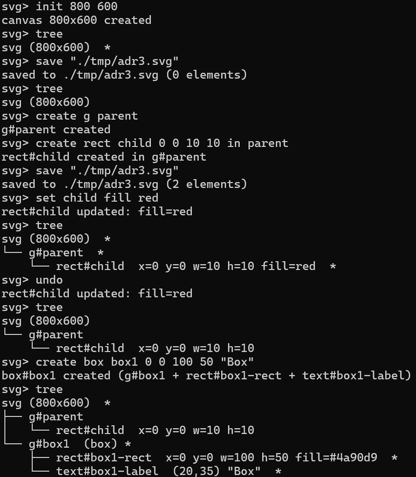
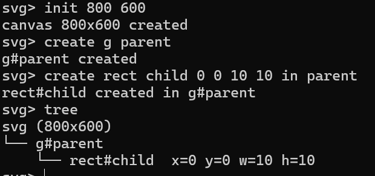

# ADR 0003：modified-star 的 dirty 语义与传播

## 状态

已接受。

## 背景

结构树每行行尾的标签可由插件通过 `TreeDecorator` 扩展点提供，内核与渲染器都无需因
新增标签而修改代码。

Phase 2 实现了两个标签插件：

- `modified-star`（`src/plugins/tree-star/index.ts`）：为存在未保存变化的行追加 `*`；
- `box-type-label`（`src/plugins/tree-box-label/index.ts`）：为 `box` 容器行追加类型标注 `(box)`。

本 ADR 文档明确 `modified-star` 三处取舍：

1. dirty 判定：内容与上次保存不一致，还是发生过编辑命令；
2. 子图形变化时，祖先容器行是否也标 `*`；
3. 同一行多个标签的拼接顺序。

## 决策

### 取舍一：dirty 判定按内容与保存点比较

采用“当前内容与最近一次 `save`/`read` 的内容不同”的方案。这样做与“文件是否有未保存变化”一致，`undo` 回到保存点后星号消失，语义自然。

- `read`：读入内容即 clean snapshot。
- `save`：写盘成功后，把当前完整文档克隆为新的 clean snapshot。
- `init`：尚未有保存点，`savedDocument` 为 `undefined`，因此新画布与新节点
  **立即显示 `*`**。
- `undo` 回到 clean snapshot：所有 `*` 消失；`redo` 后重新出现。

### 取舍二：祖先容器行也标 `*`

 `*` 会标记实际变化的节点及其所有祖先容器，包括根 `svg` 行。这样即使大纲折叠，用户也能从容器行看出其子树中存在未保存变化。

### 取舍三：同一行多个标签按 decorator 注册顺序拼接

同一行的多个标签按 decorator 的注册顺序依次拼接。

这样做的考虑是：若由内核规定顺序、或让插件互相协商，插件之间就会产生依赖，内核也要新增排序规则；交给装配顺序决定后，插件彼此无需感知，新增标签也不必改动内核与渲染器，且顺序稳定可复现。

## 验证

`tests/plugins/TreeDecorators.test.ts` 按上述决策覆盖：

- **新建即标记、保存清除、redo 复现**：`init` 后 `tree` 为 `svg (800x600)  *`，`save`
  后为 `svg (800x600)`；再 `create rect r1 0 0 10 10` 时根与 `rect#r1` 行都出现 `*`；
  `undo` 回到保存点后星号全部消失，`redo` 后重新出现。
- **祖先传播与回到保存点**：`g#parent` 内建 `rect#child` 并 `save` 后 `set child fill red`，`tree` 中根、`g#parent` 与 `rect#child` 三行都带 `*`；`undo` 后全部恢复到保存点、星号消失。
- **实例状态隔离**：两个各装载 `treeStarPlugin` 的 application，一个 `save` 后其 `tree`无星号，另一个未保存的仍显示星号，说明状态按实例隔离，不共享全局状态。
- **两个标签并存**：同时装载 `shapeBoxPlugin + treeBoxLabelPlugin + treeStarPlugin` 时`g#n1` 行为 `(box) *`；`save` 后同一行为 `(box)` 且不含 `*`；再 `set n1 fill red` 后又变为 `(box) *`。

`tests/cli/Phase1Baseline.test.ts` 覆盖缺省行为：

- **基线逐字节不变**：不装载任何标签插件时，`create g/rect/text` 后的 `tree` 输出与
  Phase 1 基线逐字节一致。

### 人工验证

先创建保存目录（示例用 `./tmp`，也可换成任意已存在且可写的目录，否则 `save` 会报 `error: cannot write file: …`）：

```powershell
New-Item -ItemType Directory -Force -Path tmp
```

启动 `npm run cli`（已含 `tree-star` 与 `tree-box-label`）：

```text
init 800 600
tree
save "./tmp/adr3.svg"
tree
create g parent
create rect child 0 0 10 10 in parent
save "./tmp/adr3.svg"
set child fill red
tree
undo
tree
create box box1 0 0 100 50 "Box"
tree
```

输出：



**缺省行为**（启动 `npm run cli:builtins`）：

```text
init 800 600
create g parent
create rect child 0 0 10 10 in parent
tree
```

输出为无任何 `*` 的基线树，与 Phase 1 逐字节一致：



## 后果

- 优点：行为与“文件是否有未保存变化”一致，`undo` 语义自然；两个标签互不感知，新增第三个标签只需再注册一个 decorator，内核与渲染器差异为 0。
- 代价：每次 `tree` 对当前图形做递归签名比较，且每次 `save` 后克隆一份 clean snapshot；当前文档规模下成本可接受。
