会话中使用/保存的`svg`文件可在代码根目录下进行查看。

## 会话 1 —— 显示类命令

```
help

init 400 300
create rect bg 0 0 400 300 #ffffff
create text title 20 40 "My Diagram"
create circle c1 100 100 20 red
create rect box 200 80 60 60 #3366ff
group markers c1 box

tree
tree markers
show c1
```

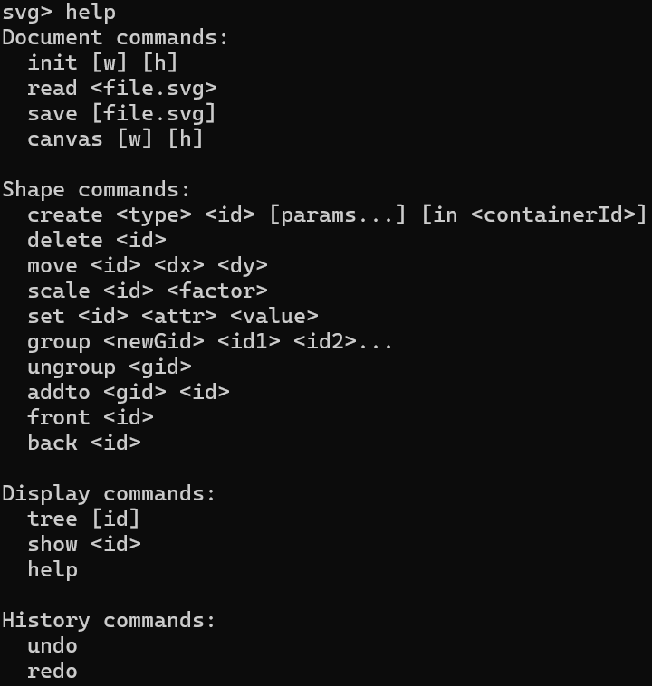

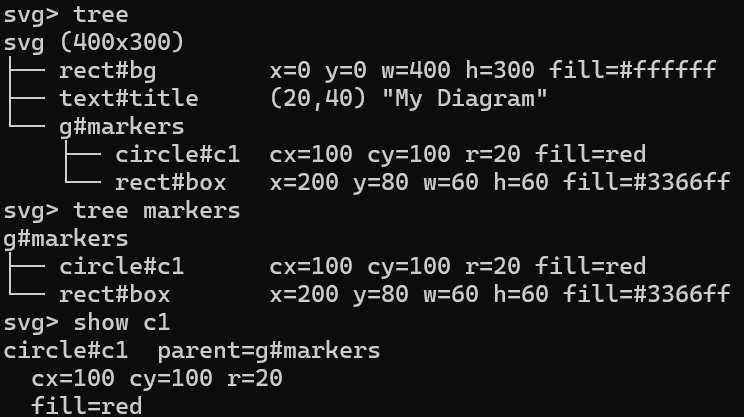

## 会话 2 —— 文档类命令 init + canvas

```
init
canvas
init 400 200
canvas 640 480
canvas
```

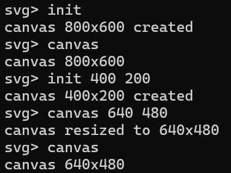

## 会话 3 —— create + in 子句 + set 白名单

```
init 800 600
create rect bg 0 0 800 600 #ffffff
create text title 20 40 "My Diagram"
create circle c1 100 100 20 red
create ellipse e1 100 50 30 20 #3366ff
create line ln1 10 10 200 10 black
create g scene

create rect bad 1 2 3
create rect bad2 1 2 3 4 5 6 7
create hexagon h1 1 2 3 4
create rect c1 0 0 5 5

create rect start 120 100 160 60 #4a90d9 in scene
create text start-label 155 135 "开始" in scene

set start fill #f5a623
set ln1 stroke-width 3
set title text "My Diagram v2"
set start label 999
set start width abc
```

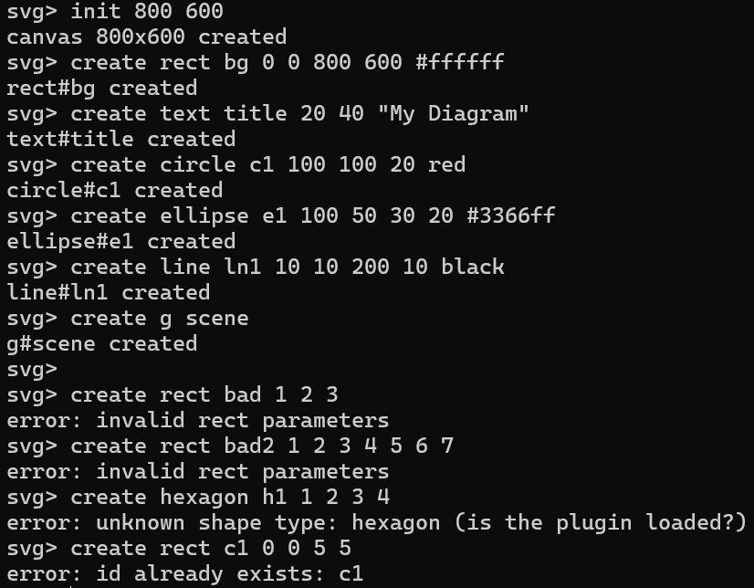

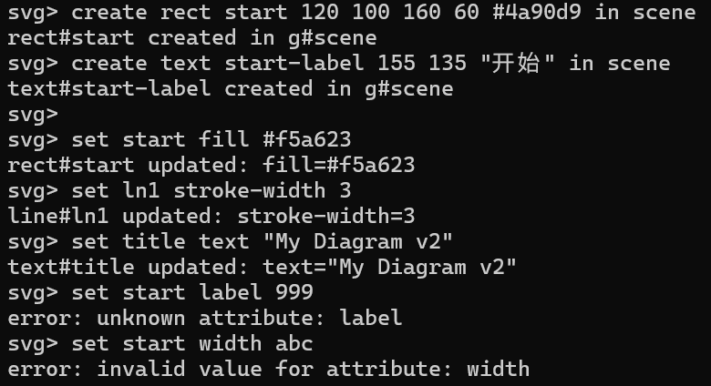

## 会话 4 编辑类 + undo/redo 粒度

```
init 800 600
create rect bg 0 0 800 600 #ffffff
create text title 20 40 "My Diagram"
create circle c1 100 100 20 red
create rect box 200 80 60 60 #3366ff
group markers c1 box

move c1 30 0
undo
redo
move markers 10 20
undo

scale c1 2
scale markers 2
scale c1 0
scale c1 -1

set title text "My Diagram v2"
undo

delete box
undo
delete markers
undo

front box
back box
undo
redo
set box width 70
undo
redo
undo
undo
undo

tree
undo
undo

init 200 150
create rect t 0 0 5 5
undo
undo
redo
redo
```

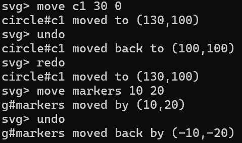

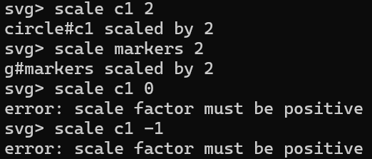

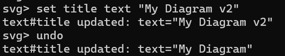

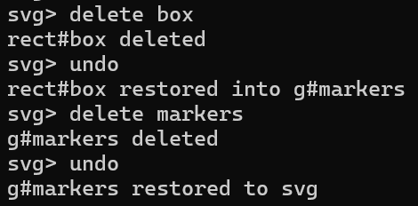

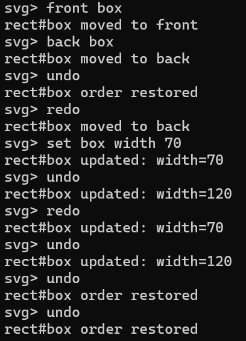

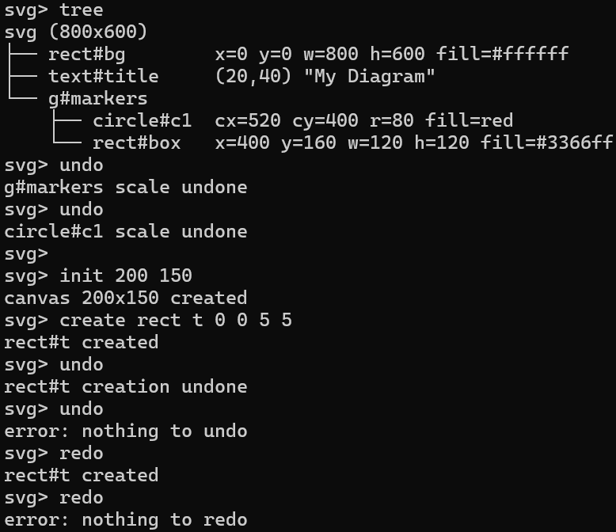

## 会话 5 —— group / ungroup / addto

```
init 500 400
create rect a 10 10 50 50 red
create rect b 100 10 50 50 blue
create rect c 200 10 50 50 green
create g box

group g1 a b c
tree g1
undo
redo

addto box a
undo

ungroup g1

create g outer
addto outer g1
ungroup g1
tree outer
undo

group bad a g1
addto g1 g1
create g top
addto top g1
ungroup top
```

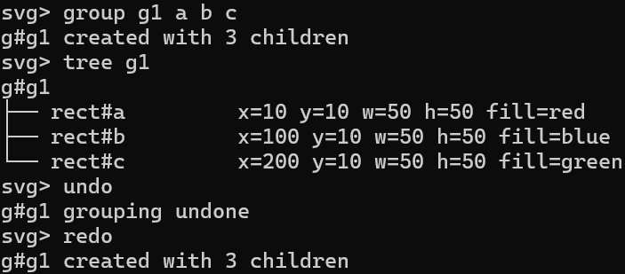

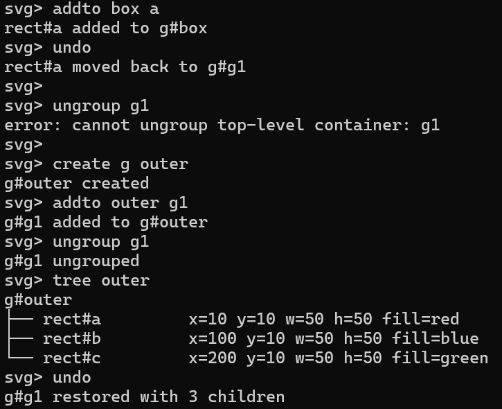

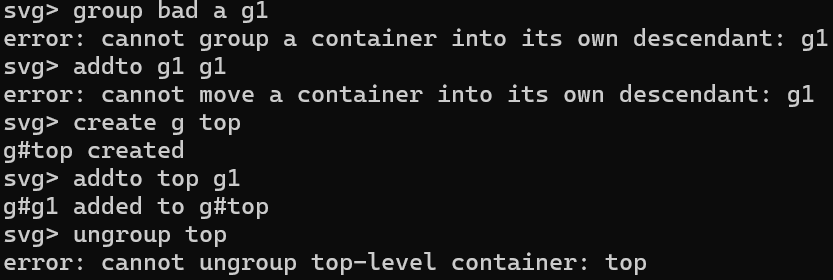

## 会话 6 —— read / save 与 round-trip

```
read other.svg
tree
show rect1

read unknown.svg

init 100 100
save
save ndir\out.svg
read missing.svg
```

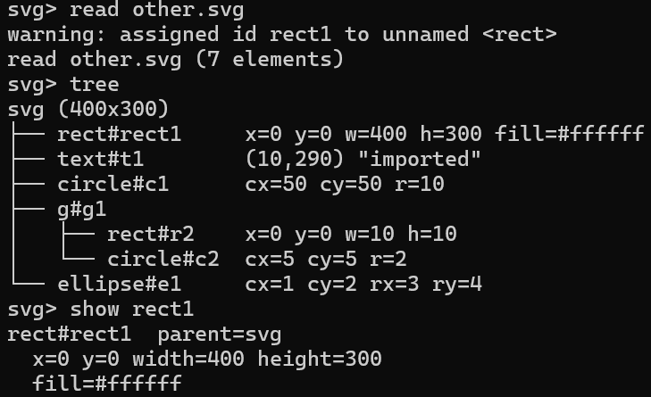

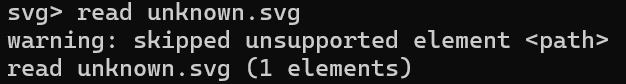

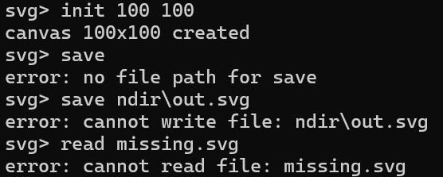

## 会话 7 —— §4.2 错误信息

```
create rect r1 0 0 5 5
init 800 600
create rect r1 0 0 5 5
create rect r1 0 0 5 5
move nope 1 1
create rect a 0 0 5 5 in nope
create rect rr 0 0 5 5
create rect b 0 0 5 5 in rr
create hexagon h 1 2
create box n1 1 2
create g c1
create rect child1 0 0 5 5 in c1
group g2 c1 child1
create g top
ungroup top
scale r1 0
scale r1 -2
read missing-a.svg
save z:\no\a.svg
```

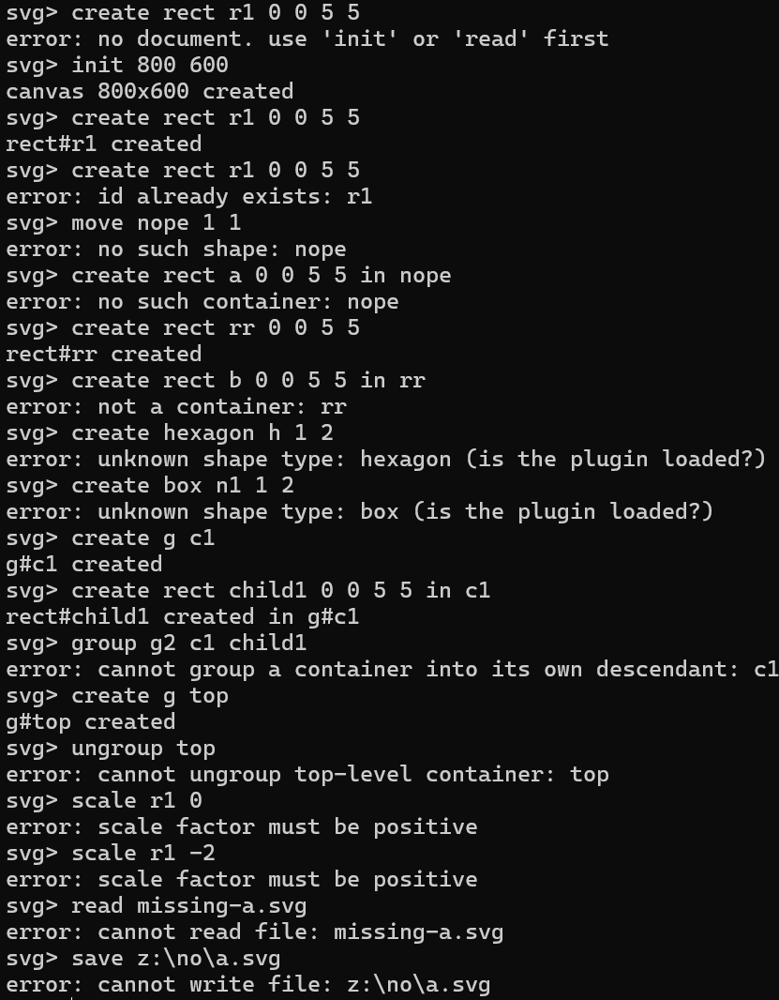

## 会话 8 —— box 阶段边界

```
init 800 600
create box n1 120 100 160 60 "开始"
```

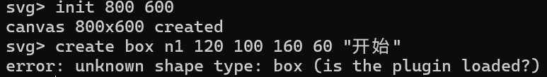

## 会话 9 —— §6 典型会话

```
init 800 600
create rect bg 0 0 800 600 #ffffff
create text title 20 40 "My Diagram"
create circle c1 100 100 20 red
create rect box 200 80 60 60 #3366ff
group markers c1 box
tree
move c1 30 0
undo
redo
set title text "My Diagram v2"
undo
group bad c1 markers
delete box
undo
save demo.svg
undo
read other.svg
tree
```

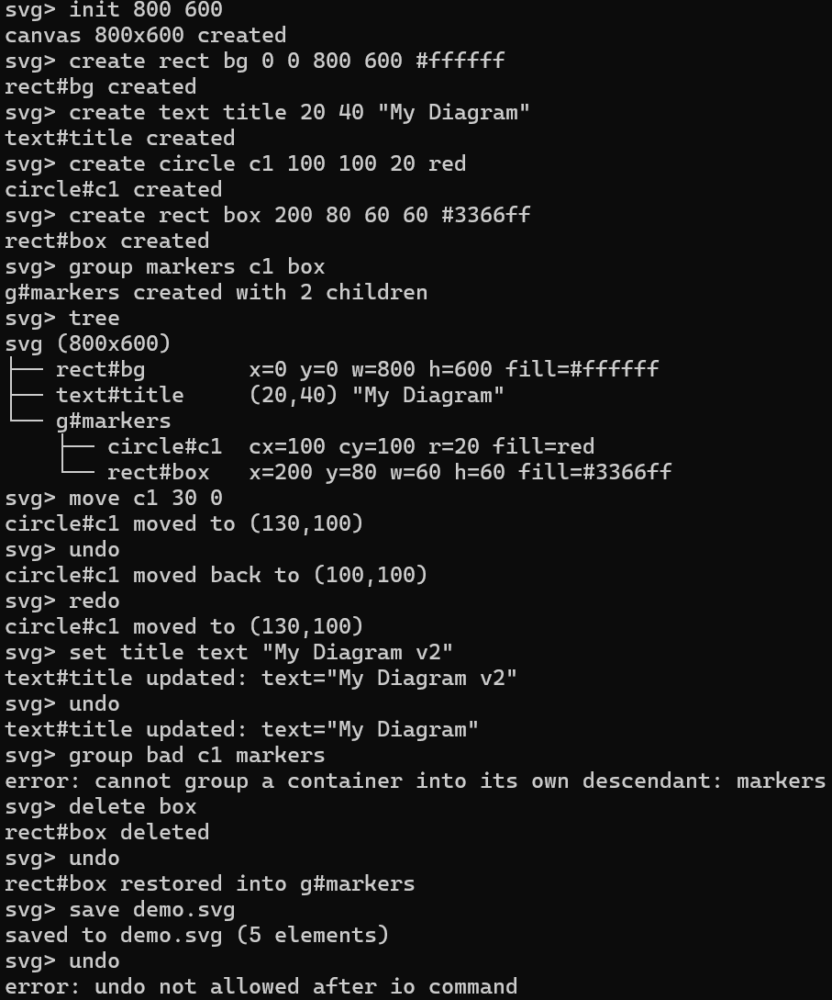

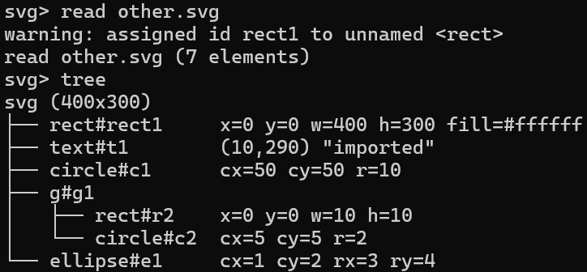

## 会话 10 —— §6.1 两节点流程图

```
init 800 600
create g flowchart
create g node1 in flowchart
create rect start 120 100 160 60 #4a90d9 in node1
create text start-label 155 135 "开始" in node1
create g node2 in flowchart
create rect process 520 100 160 60 #f5a623 in node2
create text process-label 545 135 "处理数据" in node2
create line arrow1 280 130 520 130 black in flowchart
tree
move node2 0 100
undo
set process-label text "处理数据 v2"
save flowchart.svg
```

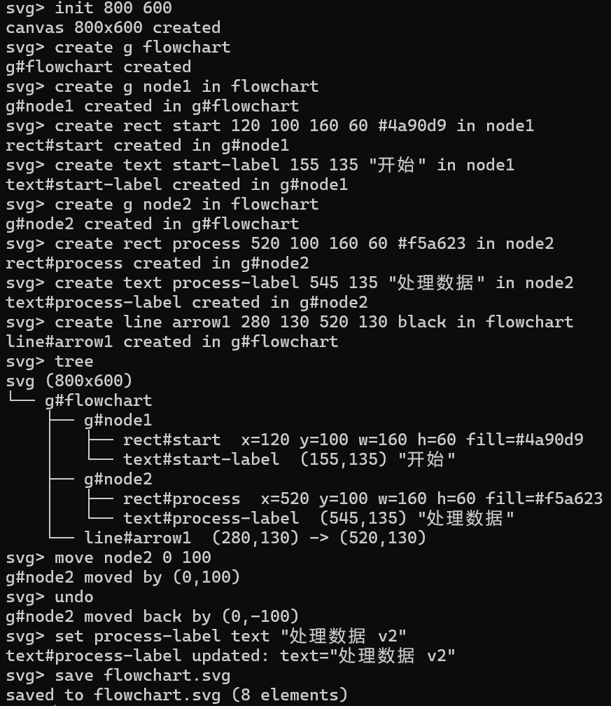